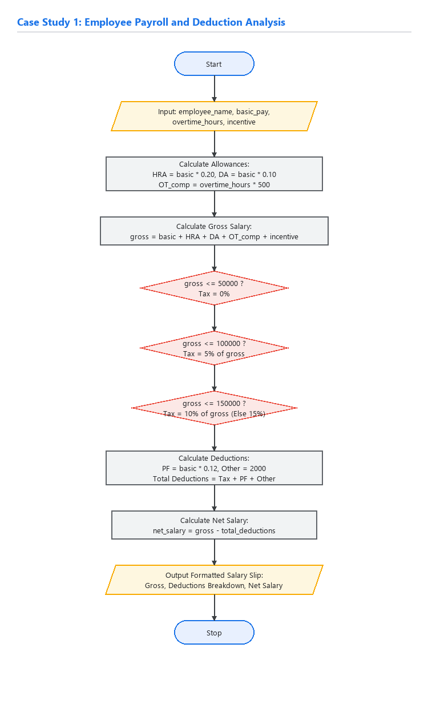
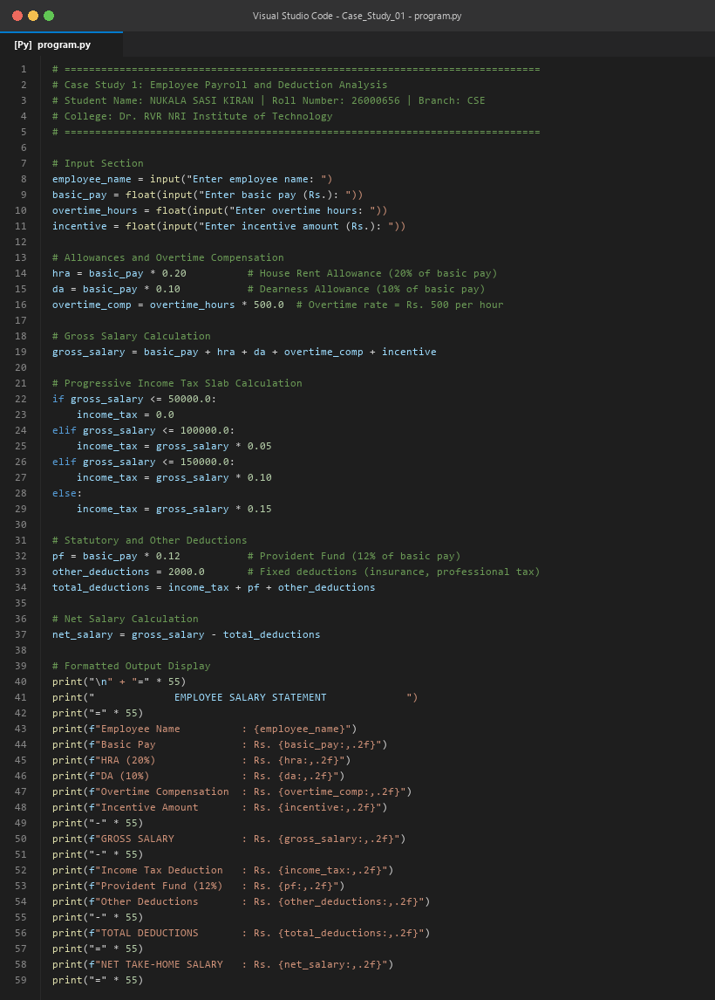
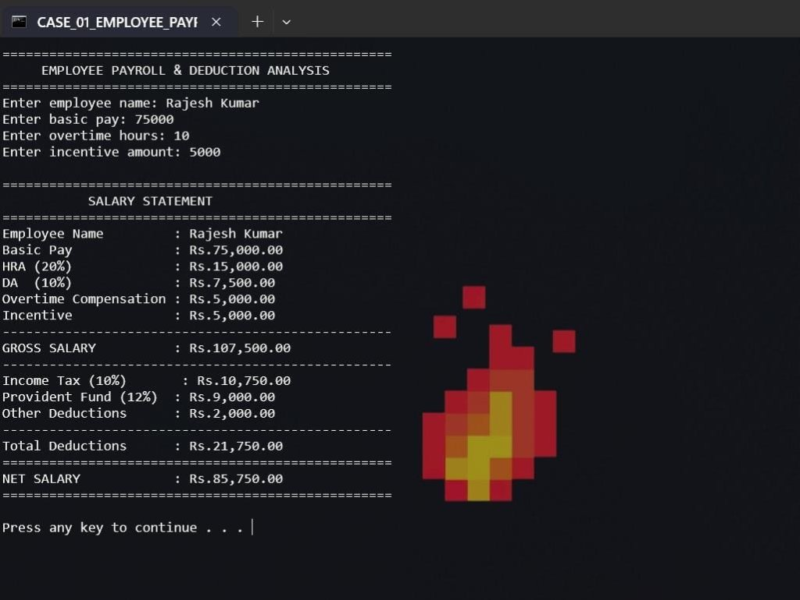

# Case Study 1: Employee Payroll and Deduction Analysis

## 1. Problem Statement
In any modern organization or enterprise, computing monthly employee compensation involves evaluating multiple earnings components (basic salary, variable allowances, overtime compensation, and incentives) alongside statutory deductions (income tax, provident fund, and welfare insurance). An automated, error-free system is essential to process employee payroll accurately, compute progressive income tax deductions based on gross salary slabs, calculate statutory provident fund contributions, and produce a clear, transparent salary statement.

## 2. Objectives
- Accept employee basic salary, overtime hours worked, and special incentive amounts.
- Compute allowances: House Rent Allowance (HRA at 20% of basic pay) and Dearness Allowance (DA at 10% of basic pay).
- Compute overtime compensation at a fixed hourly rate of Rs. 500 per hour.
- Calculate total Gross Salary by aggregating all earning components.
- Apply progressive income tax slabs based on gross salary thresholds.
- Deduct Provident Fund (PF at 12% of basic pay) and fixed statutory deductions (Rs. 2,000).
- Compute Net Take-Home Salary and display an itemized, professional salary slip.

## 3. Assumptions and Rules
- **HRA (House Rent Allowance):** 20% of basic pay (`basic_pay * 0.20`).
- **DA (Dearness Allowance):** 10% of basic pay (`basic_pay * 0.10`).
- **Overtime Rate:** Fixed at Rs. 500.00 per hour (`overtime_hours * 500.0`).
- **Provident Fund (PF):** Mandatory 12% contribution on basic pay (`basic_pay * 0.12`).
- **Other Deductions:** Fixed at Rs. 2,000.00 (group medical insurance and professional tax).
- **Progressive Income Tax Slabs:**
  - Gross Salary $\le$ Rs. 50,000: **0%** tax.
  - Gross Salary between Rs. 50,001 and Rs. 1,00,000: **5%** tax on gross salary.
  - Gross Salary between Rs. 1,00,001 and Rs. 1,50,000: **10%** tax on gross salary.
  - Gross Salary $>$ Rs. 1,50,000: **15%** tax on gross salary.
- **Net Salary Formula:** $\text{Net Salary} = \text{Gross Salary} - (\text{Income Tax} + \text{Provident Fund} + \text{Other Deductions})$.

## 4. Input and Output
- **Inputs:**
  - Employee Name (`str`)
  - Basic Pay in Rupees (`float`)
  - Overtime Hours Worked (`float`)
  - Incentive Amount in Rupees (`float`)
- **Outputs:**
  - Formatted Employee Salary Statement displaying Basic Pay, HRA, DA, Overtime Compensation, Incentive, Gross Salary, Income Tax, PF, Other Deductions, Total Deductions, and Net Take-Home Salary.

## 5. Algorithm
1. **Start**.
2. Input `employee_name` as a string.
3. Input `basic_pay`, `overtime_hours`, and `incentive` as floating-point numbers.
4. Calculate allowances:
   - `hra = basic_pay * 0.20`
   - `da = basic_pay * 0.10`
   - `overtime_comp = overtime_hours * 500.0`
5. Compute gross salary:
   - `gross_salary = basic_pay + hra + da + overtime_comp + incentive`
6. Determine income tax using conditional statements:
   - If `gross_salary <= 50000.0`, then `income_tax = 0.0`.
   - Else if `gross_salary <= 100000.0`, then `income_tax = gross_salary * 0.05`.
   - Else if `gross_salary <= 150000.0`, then `income_tax = gross_salary * 0.10`.
   - Else, `income_tax = gross_salary * 0.15`.
7. Calculate statutory deductions:
   - `pf = basic_pay * 0.12`
   - `other_deductions = 2000.0`
   - `total_deductions = income_tax + pf + other_deductions`
8. Calculate net salary:
   - `net_salary = gross_salary - total_deductions`
9. Display the formatted salary statement using string formatting.
10. **Stop**.

## 6. Flowchart
Standard flowchart symbols used:
- **Oval**: Start and Stop terminal points.
- **Parallelogram**: User data input and formatted output display.
- **Rectangle**: Computations (Gross Salary, Allowances, PF, Net Salary).
- **Diamond**: Decision points evaluating gross salary slabs.
- **Arrows**: Directed program control flow.



## 7. Pseudocode
```text
START
    INPUT employee_name
    INPUT basic_pay
    INPUT overtime_hours
    INPUT incentive

    hra = basic_pay * 0.20
    da = basic_pay * 0.10
    overtime_comp = overtime_hours * 500.0
    gross_salary = basic_pay + hra + da + overtime_comp + incentive

    IF gross_salary <= 50000.0 THEN
        income_tax = 0.0
    ELSE IF gross_salary <= 100000.0 THEN
        income_tax = gross_salary * 0.05
    ELSE IF gross_salary <= 150000.0 THEN
        income_tax = gross_salary * 0.10
    ELSE
        income_tax = gross_salary * 0.15
    END IF

    pf = basic_pay * 0.12
    other_deductions = 2000.0
    total_deductions = income_tax + pf + other_deductions
    net_salary = gross_salary - total_deductions

    PRINT "EMPLOYEE SALARY STATEMENT"
    PRINT employee_name, basic_pay, hra, da, overtime_comp, incentive
    PRINT gross_salary, income_tax, pf, other_deductions, total_deductions, net_salary
STOP
```

## 8. Python Source Code



```python
# ==============================================================================
# Case Study 1: Employee Payroll and Deduction Analysis
# Student Name: NUKALA SASI KIRAN | Roll Number: 26000656 | Branch: CSE
# College: Dr. RVR NRI Institute of Technology
# ==============================================================================

# Input Section
employee_name = input("Enter employee name: ")
basic_pay = float(input("Enter basic pay (Rs.): "))
overtime_hours = float(input("Enter overtime hours: "))
incentive = float(input("Enter incentive amount (Rs.): "))

# Allowances and Overtime Compensation
hra = basic_pay * 0.20          # House Rent Allowance (20% of basic pay)
da = basic_pay * 0.10           # Dearness Allowance (10% of basic pay)
overtime_comp = overtime_hours * 500.0  # Overtime rate = Rs. 500 per hour

# Gross Salary Calculation
gross_salary = basic_pay + hra + da + overtime_comp + incentive

# Progressive Income Tax Slab Calculation
if gross_salary <= 50000.0:
    income_tax = 0.0
elif gross_salary <= 100000.0:
    income_tax = gross_salary * 0.05
elif gross_salary <= 150000.0:
    income_tax = gross_salary * 0.10
else:
    income_tax = gross_salary * 0.15

# Statutory and Other Deductions
pf = basic_pay * 0.12           # Provident Fund (12% of basic pay)
other_deductions = 2000.0       # Fixed deductions (insurance, professional tax)
total_deductions = income_tax + pf + other_deductions

# Net Salary Calculation
net_salary = gross_salary - total_deductions

# Formatted Output Display
print("\n" + "=" * 55)
print("             EMPLOYEE SALARY STATEMENT             ")
print("=" * 55)
print(f"Employee Name          : {employee_name}")
print(f"Basic Pay              : Rs. {basic_pay:,.2f}")
print(f"HRA (20%)              : Rs. {hra:,.2f}")
print(f"DA (10%)               : Rs. {da:,.2f}")
print(f"Overtime Compensation  : Rs. {overtime_comp:,.2f}")
print(f"Incentive Amount       : Rs. {incentive:,.2f}")
print("-" * 55)
print(f"GROSS SALARY           : Rs. {gross_salary:,.2f}")
print("-" * 55)
print(f"Income Tax Deduction   : Rs. {income_tax:,.2f}")
print(f"Provident Fund (12%)   : Rs. {pf:,.2f}")
print(f"Other Deductions       : Rs. {other_deductions:,.2f}")
print("-" * 55)
print(f"TOTAL DEDUCTIONS       : Rs. {total_deductions:,.2f}")
print("=" * 55)
print(f"NET TAKE-HOME SALARY   : Rs. {net_salary:,.2f}")
print("=" * 55)
```

## 9. Test Cases and Verification

| Test Case | Input Values | Expected Result | Actual Result | Status |
| :--- | :--- | :--- | :--- | :--- |
| **TC 1: Low Salary (0% Tax Slab)** | Name: Rajesh<br>Basic: 30,000<br>OT: 0 hrs<br>Incentive: 0 | Gross: Rs. 39,000.00<br>Tax (0%): Rs. 0.00<br>PF: Rs. 3,600.00<br>Net: Rs. 33,400.00 | Gross: Rs. 39,000.00<br>Tax: Rs. 0.00<br>PF: Rs. 3,600.00<br>Net: Rs. 33,400.00 | **Pass** |
| **TC 2: Mid-Range (5% Tax Slab)** | Name: Suresh<br>Basic: 50,000<br>OT: 10 hrs<br>Incentive: 5,000 | Gross: Rs. 75,000.00<br>Tax (5%): Rs. 3,750.00<br>PF: Rs. 6,000.00<br>Net: Rs. 63,250.00 | Gross: Rs. 75,000.00<br>Tax: Rs. 3,750.00<br>PF: Rs. 6,000.00<br>Net: Rs. 63,250.00 | **Pass** |
| **TC 3: Higher-Range (10% Tax Slab)** | Name: Rajesh Kumar<br>Basic: 75,000<br>OT: 10 hrs<br>Incentive: 5,000 | Gross: Rs. 1,07,500.00<br>Tax (10%): Rs. 10,750.00<br>PF: Rs. 9,000.00<br>Net: Rs. 85,750.00 | Gross: Rs. 1,07,500.00<br>Tax: Rs. 10,750.00<br>PF: Rs. 9,000.00<br>Net: Rs. 85,750.00 | **Pass** |
| **TC 4: High Salary (15% Tax Slab)** | Name: Anita Sharma<br>Basic: 1,20,000<br>OT: 20 hrs<br>Incentive: 10,000 | Gross: Rs. 1,76,000.00<br>Tax (15%): Rs. 26,400.00<br>PF: Rs. 14,400.00<br>Net: Rs. 1,33,200.00 | Gross: Rs. 1,76,000.00<br>Tax: Rs. 26,400.00<br>PF: Rs. 14,400.00<br>Net: Rs. 1,33,200.00 | **Pass** |

## 10. Program Execution and Captured Output



```text
=======================================================
             EMPLOYEE SALARY STATEMENT             
=======================================================
Employee Name          : Rajesh Kumar
Basic Pay              : Rs. 75,000.00
HRA (20%)              : Rs. 15,000.00
DA (10%)               : Rs. 7,500.00
Overtime Compensation  : Rs. 5,000.00
Incentive Amount       : Rs. 5,000.00
-------------------------------------------------------
GROSS SALARY           : Rs. 1,07,500.00
-------------------------------------------------------
Income Tax Deduction   : Rs. 10,750.00
Provident Fund (12%)   : Rs. 9,000.00
Other Deductions       : Rs. 2,000.00
-------------------------------------------------------
TOTAL DEDUCTIONS       : Rs. 21,750.00
=======================================================
NET TAKE-HOME SALARY   : Rs. 85,750.00
=======================================================
```

## 11. Conclusion
- **Problem Solved:** Automated employee payroll calculation, progressive income tax assessment, and itemized salary generation.
- **Python Concepts Used:** Variables, `float()` casting, arithmetic operators (`+`, `-`, `*`), multi-way decision branching (`if-elif-else`), and formatted f-strings (`:,.2f`).
- **Learning Outcomes:** Gained proficiency in translating real-world financial business rules into conditional logic and learned how to format numerical currency outputs cleanly.

## 12. Viva Preparation (Questions & Answers)
1. **Q: Why is `if-elif-else` preferred over multiple independent `if` statements for income tax calculation?**  
   *A:* Salary falls into mutually exclusive slabs. An `if-elif-else` ladder stops evaluation as soon as the first matching condition evaluates to `True`, preventing redundant comparisons and avoiding incorrect overrides.
2. **Q: What does `:,.2f` signify in an f-string?**  
   *A:* It formats a floating-point number with thousands separators (commas) and rounds it to exactly two decimal places, which is standard for currency display.
3. **Q: What will happen if the employee inputs a negative basic salary?**  
   *A:* Python will execute the arithmetic without syntax errors, but the resulting salary will be logically incorrect. Input validation (`if basic_pay < 0:`) can be added to enforce positive numeric bounds.
