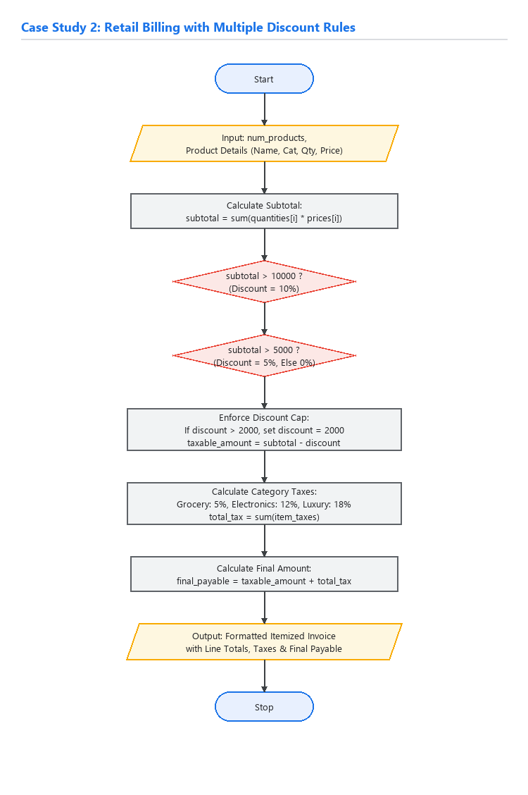
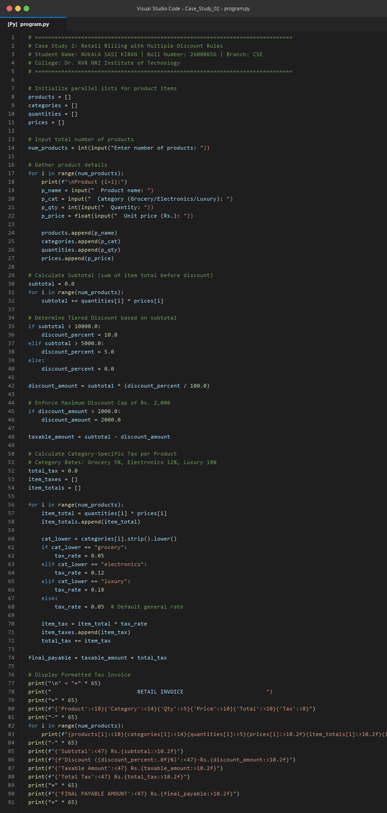
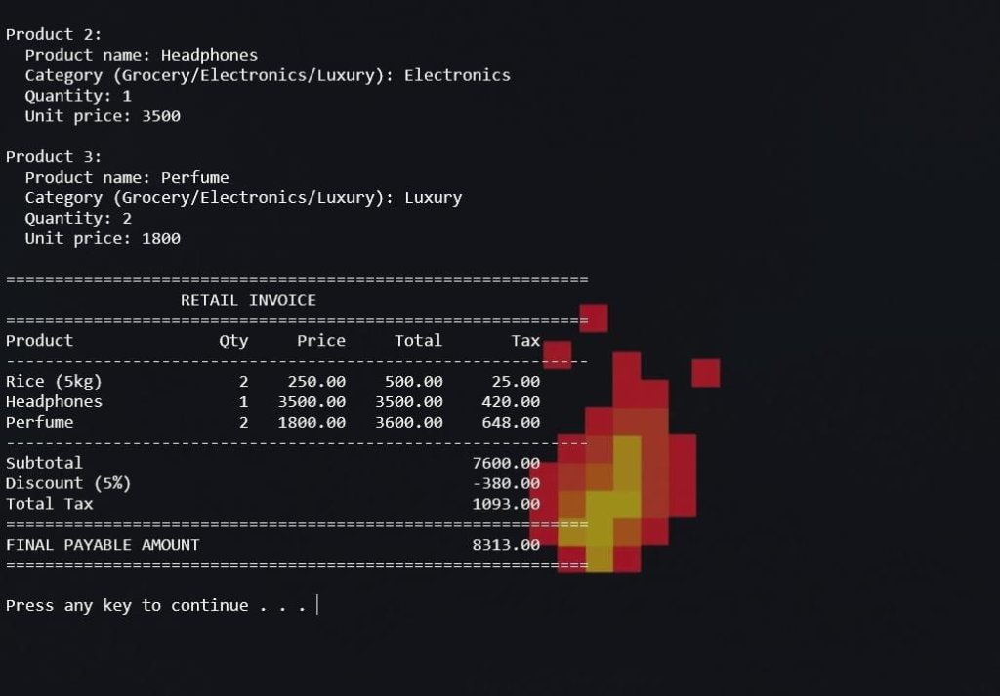

# Case Study 2: Retail Billing with Multiple Discount Rules

## 1. Problem Statement
Retail stores and supermarkets handle thousands of diverse customer purchases daily across different product categories (e.g., Grocery, Electronics, and Luxury). Different merchandise items carry distinct statutory Goods and Services Tax (GST) rates. Furthermore, stores incentivize larger customer purchases through tiered threshold discounts, while capping total discounts to protect profit margins. Developing a reliable, automated itemized billing program ensures swift, transparent, and error-free checkout for shoppers.

## 2. Objectives
- Capture itemized purchases for multiple products (name, category, quantity, unit price).
- Compute line totals for each product and accumulate the gross purchase subtotal.
- Apply a tiered promotional discount policy based on subtotal thresholds.
- Enforce a strict ceiling (cap) of Rs. 2,000 on discounts.
- Apply category-specific tax rates (Grocery: 5%, Electronics: 12%, Luxury: 18%).
- Generate a neat, professional itemized invoice showing line details, applied discounts, taxes, and the net payable amount.

## 3. Assumptions and Rules
- **Category Tax Rates:**
  - Grocery: **5%** (`item_total * 0.05`)
  - Electronics: **12%** (`item_total * 0.12`)
  - Luxury: **18%** (`item_total * 0.18`)
  - General / Other: **5%** default
- **Promotional Discount Slabs:**
  - Subtotal $\le$ Rs. 5,000: **0%** discount.
  - Subtotal between Rs. 5,001 and Rs. 10,000: **5%** discount on subtotal.
  - Subtotal $>$ Rs. 10,000: **10%** discount on subtotal.
- **Maximum Discount Cap:** Discount amount cannot exceed **Rs. 2,000.00**.
- **Final Payable Computation:** $\text{Taxable Subtotal} = \text{Subtotal} - \text{Discount Amount}$, and $\text{Final Payable} = \text{Taxable Subtotal} + \text{Total Taxes}$.

## 4. Input and Output
- **Inputs:**
  - Number of distinct products (`int`)
  - For each product: Product Name (`str`), Category (`str`), Quantity (`int`), Unit Price (`float`).
- **Outputs:**
  - Tabular Retail Invoice detailing Product Name, Category, Quantity, Unit Price, Total, and Tax.
  - Summary footer displaying Gross Subtotal, Discount percentage and amount, Taxable Subtotal, Total Tax, and Final Payable Amount.

## 5. Algorithm
1. **Start**.
2. Initialize empty lists: `products`, `categories`, `quantities`, `prices`.
3. Read `num_products` as an integer.
4. Loop `i` from 0 to `num_products - 1`:
   - Prompt and read `p_name`, `p_cat`, `p_qty`, `p_price`.
   - Append them to their respective lists.
5. Compute `subtotal` by summing `quantities[i] * prices[i]` across all products.
6. Evaluate tiered discount:
   - If `subtotal > 10000.0`, set `discount_percent = 10.0`.
   - Else if `subtotal > 5000.0`, set `discount_percent = 5.0`.
   - Else, set `discount_percent = 0.0`.
7. Compute `discount_amount = subtotal * (discount_percent / 100.0)`.
8. If `discount_amount > 2000.0`, cap `discount_amount = 2000.0`.
9. Compute `taxable_amount = subtotal - discount_amount`.
10. Loop `i` from 0 to `num_products - 1` to compute category tax:
    - If category is "Grocery", `tax_rate = 0.05`.
    - Else if category is "Electronics", `tax_rate = 0.12`.
    - Else if category is "Luxury", `tax_rate = 0.18`.
    - Else, `tax_rate = 0.05`.
    - `item_tax = (quantities[i] * prices[i]) * tax_rate`.
    - Accumulate into `total_tax`.
11. Compute `final_payable = taxable_amount + total_tax`.
12. Display the formatted invoice table and totals.
13. **Stop**.

## 6. Flowchart
Standard flowchart symbols used:
- **Oval**: Start and Stop terminal points.
- **Parallelogram**: User inputs for products and formatted invoice output.
- **Rectangle**: Computations (Subtotal, discounts, taxes, final payable).
- **Diamond**: Decision points evaluating subtotal discount tiers and category tax rates.
- **Arrows**: Directed program control flow.



## 7. Pseudocode
```text
START
    products = [], categories = [], quantities = [], prices = []
    INPUT num_products

    FOR i FROM 0 TO num_products - 1 DO
        INPUT p_name, p_cat, p_qty, p_price
        APPEND to respective lists
    END FOR

    subtotal = 0.0
    FOR i FROM 0 TO num_products - 1 DO
        subtotal = subtotal + (quantities[i] * prices[i])
    END FOR

    IF subtotal > 10000.0 THEN
        discount_percent = 10.0
    ELSE IF subtotal > 5000.0 THEN
        discount_percent = 5.0
    ELSE
        discount_percent = 0.0
    END IF

    discount_amount = subtotal * (discount_percent / 100.0)
    IF discount_amount > 2000.0 THEN
        discount_amount = 2000.0
    END IF

    taxable_amount = subtotal - discount_amount
    total_tax = 0.0

    FOR i FROM 0 TO num_products - 1 DO
        line_total = quantities[i] * prices[i]
        IF categories[i] == "Grocery" THEN tax_rate = 0.05
        ELSE IF categories[i] == "Electronics" THEN tax_rate = 0.12
        ELSE IF categories[i] == "Luxury" THEN tax_rate = 0.18
        ELSE tax_rate = 0.05 END IF
        total_tax = total_tax + (line_total * tax_rate)
    END FOR

    final_payable = taxable_amount + total_tax
    PRINT invoice table, subtotal, discount_amount, total_tax, final_payable
STOP
```

## 8. Python Source Code



```python
# ==============================================================================
# Case Study 2: Retail Billing with Multiple Discount Rules
# Student Name: NUKALA SASI KIRAN | Roll Number: 26000656 | Branch: CSE
# College: Dr. RVR NRI Institute of Technology
# ==============================================================================

# Initialize parallel lists for product items
products = []
categories = []
quantities = []
prices = []

# Input total number of products
num_products = int(input("Enter number of products: "))

# Gather product details
for i in range(num_products):
    print(f"\nProduct {i+1}:")
    p_name = input("  Product name: ")
    p_cat = input("  Category (Grocery/Electronics/Luxury): ")
    p_qty = int(input("  Quantity: "))
    p_price = float(input("  Unit price (Rs.): "))
    
    products.append(p_name)
    categories.append(p_cat)
    quantities.append(p_qty)
    prices.append(p_price)

# Calculate Subtotal (sum of item total before discount)
subtotal = 0.0
for i in range(num_products):
    subtotal += quantities[i] * prices[i]

# Determine Tiered Discount based on subtotal
if subtotal > 10000.0:
    discount_percent = 10.0
elif subtotal > 5000.0:
    discount_percent = 5.0
else:
    discount_percent = 0.0

discount_amount = subtotal * (discount_percent / 100.0)

# Enforce Maximum Discount Cap of Rs. 2,000
if discount_amount > 2000.0:
    discount_amount = 2000.0

taxable_amount = subtotal - discount_amount

# Calculate Category-Specific Tax per Product
# Category Rates: Grocery 5%, Electronics 12%, Luxury 18%
total_tax = 0.0
item_taxes = []
item_totals = []

for i in range(num_products):
    item_total = quantities[i] * prices[i]
    item_totals.append(item_total)
    
    cat_lower = categories[i].strip().lower()
    if cat_lower == "grocery":
        tax_rate = 0.05
    elif cat_lower == "electronics":
        tax_rate = 0.12
    elif cat_lower == "luxury":
        tax_rate = 0.18
    else:
        tax_rate = 0.05  # Default general rate
        
    item_tax = item_total * tax_rate
    item_taxes.append(item_tax)
    total_tax += item_tax

final_payable = taxable_amount + total_tax

# Display Formatted Tax Invoice
print("\n" + "=" * 65)
print("                          RETAIL INVOICE                         ")
print("=" * 65)
print(f"{'Product':<18}{'Category':<14}{'Qty':>5}{'Price':>10}{'Total':>10}{'Tax':>8}")
print("-" * 65)
for i in range(num_products):
    print(f"{products[i]:<18}{categories[i]:<14}{quantities[i]:>5}{prices[i]:>10.2f}{item_totals[i]:>10.2f}{item_taxes[i]:>8.2f}")
print("-" * 65)
print(f"{'Subtotal':<47} Rs.{subtotal:>10.2f}")
print(f"{f'Discount ({discount_percent:.0f}%)':<47}-Rs.{discount_amount:>10.2f}")
print(f"{'Taxable Amount':<47} Rs.{taxable_amount:>10.2f}")
print(f"{'Total Tax':<47} Rs.{total_tax:>10.2f}")
print("=" * 65)
print(f"{'FINAL PAYABLE AMOUNT':<47} Rs.{final_payable:>10.2f}")
print("=" * 65)
```

## 9. Test Cases and Verification

| Test Case | Input Description | Expected Result | Actual Result | Status |
| :--- | :--- | :--- | :--- | :--- |
| **TC 1: Mid-Tier Purchase (5% Discount)** | 3 Items:<br>- Rice (2 x 250, Grocery)<br>- Headphones (1 x 3500, Electronics)<br>- Perfume (2 x 1800, Luxury) | Subtotal: Rs. 7,600.00<br>Discount (5%): Rs. 380.00<br>Taxable: Rs. 7,220.00<br>Tax: Rs. 1,093.00<br>Payable: Rs. 8,313.00 | Subtotal: Rs. 7,600.00<br>Discount: Rs. 380.00<br>Taxable: Rs. 7,220.00<br>Tax: Rs. 1,093.00<br>Payable: Rs. 8,313.00 | **Pass** |
| **TC 2: Small Purchase (< Rs. 5,000 Threshold)** | 1 Item:<br>- Book (2 x 500, Grocery) | Subtotal: Rs. 1,000.00<br>Discount (0%): Rs. 0.00<br>Tax (5%): Rs. 50.00<br>Payable: Rs. 1,050.00 | Subtotal: Rs. 1,000.00<br>Discount: Rs. 0.00<br>Tax: Rs. 50.00<br>Payable: Rs. 1,050.00 | **Pass** |
| **TC 3: High Purchase (Discount Cap Enforced)** | 2 Items:<br>- Laptop (1 x 25,000, Electronics)<br>- Watch (1 x 5,000, Luxury) | Subtotal: Rs. 30,000.00<br>Raw 10% Disc: Rs. 3,000<br>Capped Disc: Rs. 2,000.00<br>Taxable: Rs. 28,000.00<br>Tax: Rs. 3,900.00<br>Payable: Rs. 31,900.00 | Subtotal: Rs. 30,000.00<br>Discount: Rs. 2,000.00<br>Taxable: Rs. 28,000.00<br>Tax: Rs. 3,900.00<br>Payable: Rs. 31,900.00 | **Pass** |

## 10. Program Execution and Captured Output



```text
=================================================================
                          RETAIL INVOICE                         
=================================================================
Product           Category        Qty     Price     Total     Tax
-----------------------------------------------------------------
Rice (5kg)        Grocery           2    250.00    500.00   25.00
Headphones        Electronics       1   3500.00   3500.00  420.00
Perfume           Luxury            2   1800.00   3600.00  648.00
-----------------------------------------------------------------
Subtotal                                        Rs.   7600.00
Discount (5%)                                  -Rs.    380.00
Taxable Amount                                  Rs.   7220.00
Total Tax                                       Rs.   1093.00
=================================================================
FINAL PAYABLE AMOUNT                            Rs.   8313.00
=================================================================
```

## 11. Conclusion
- **Problem Solved:** Itemized multi-product retail invoice generation with category-based taxes, tiered discount calculations, and discount cap enforcement.
- **Python Concepts Used:** Dynamic list collection (`append()`), `for` loop with `range()`, nested list lookups, conditional branching (`if-elif-else`), and structured tabular string formatting.
- **Learning Outcomes:** Mastered parallel list processing to synchronize associated attributes of items and implemented real-world retail pricing constraints.

## 12. Viva Preparation (Questions & Answers)
1. **Q: What is the benefit of using `strip().lower()` when checking categories?**  
   *A:* It removes accidental leading/trailing spaces and converts the input string to lowercase, preventing input matching errors due to case variations (e.g., `"Grocery"`, `"grocery"`, `" GROCERY "`).
2. **Q: How does the discount cap prevent business revenue loss?**  
   *A:* An `if discount_amount > 2000.0:` condition strictly clamps the maximum allowable discount to Rs. 2,000, ensuring high-value purchases do not receive excessive discounts beyond company policy.
3. **Q: Could this program handle an arbitrary number of products?**  
   *A:* Yes, by accepting `num_products` dynamically and using `for i in range(num_products):`, the program scales to any number of items entered by the user.
