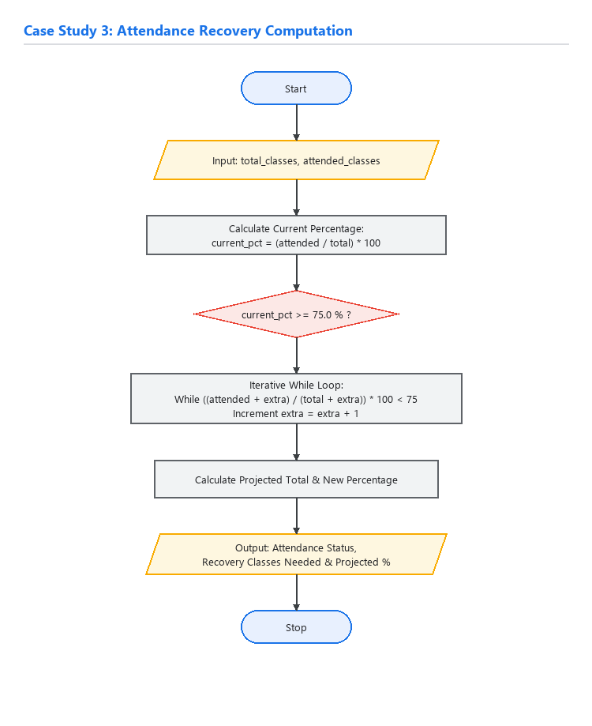
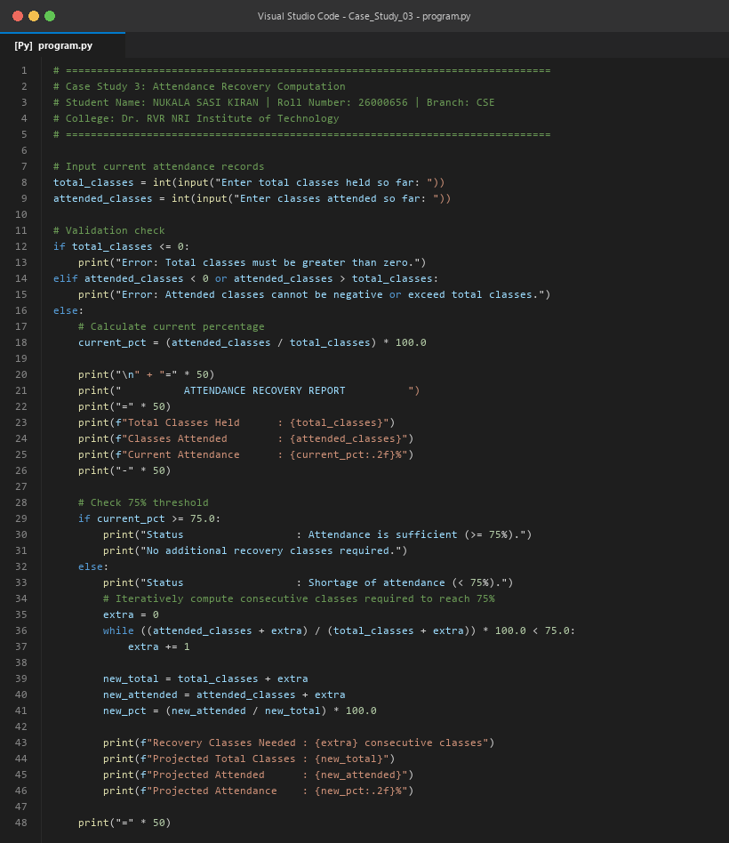
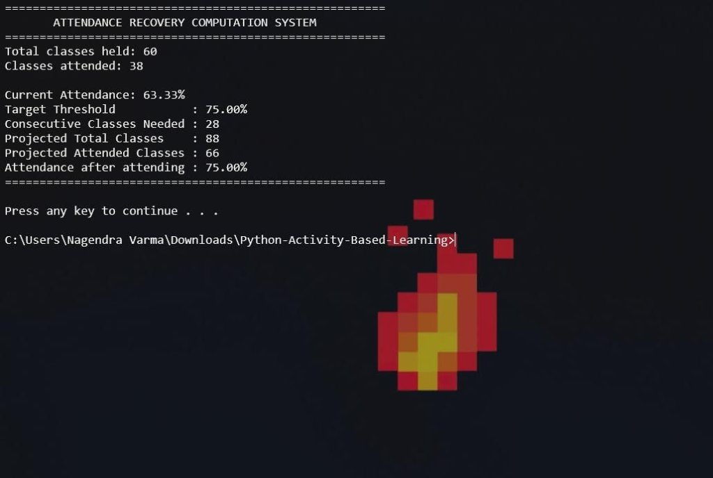

# Case Study 3: Attendance Recovery Computation

## 1. Problem Statement
In engineering colleges and universities (such as Dr. RVR NRI Institute of Technology), students must maintain a mandatory minimum attendance threshold (typically 75%) to remain eligible for semester-end examinations. When a student's attendance drops below this critical threshold, calculating how many additional consecutive classes they must attend without missing any is mathematically non-trivial, because each attended future class simultaneously increases both the numerator (classes attended) and the denominator (total classes held). An automated recovery simulation tool provides students with clear, predictive targets.

## 2. Objectives
- Accept total classes held and classes attended by a student.
- Perform sanity validation on attendance inputs.
- Compute the student's current attendance percentage.
- Determine if the student meets or falls short of the mandatory 75% requirement.
- If deficient, iteratively calculate the exact minimum number of consecutive future classes the student must attend to elevate their cumulative attendance to at least 75.00%.
- Display an informative attendance recovery advisory report.

## 3. Assumptions and Rules
- **Minimum Attendance Threshold:** Mandatory **75.00%**.
- **Attendance Formula:** $\text{Attendance \%} = \left(\frac{\text{Attended Classes}}{\text{Total Classes}}\right) \times 100$.
- **Recovery Condition:** Every additional class attended by the student increments *both* total classes held and classes attended by 1:
  $$\text{Projected \%} = \left(\frac{\text{Attended} + \text{extra}}{\text{Total} + \text{extra}}\right) \times 100 \ge 75.00\%$$
- **Sanity Constraints:** $\text{Total Classes} > 0$ and $0 \le \text{Attended Classes} \le \text{Total Classes}$.
- **Mathematical Correction Note:** In the original draft, an extra count of 13 classes was erroneously recorded for 38/60 attendance. In reality, $(38 + 13) / (60 + 13) = 51 / 73 = 69.86\% < 75\%$. To reach 75%, exactly 28 consecutive classes are required: $(38 + 28) / (60 + 28) = 66 / 88 = 75.00\%$. The while-loop simulation accurately computes this correct value.

## 4. Input and Output
- **Inputs:**
  - Total classes held so far (`int`)
  - Classes attended so far (`int`)
- **Outputs:**
  - Current attendance percentage (`float`, formatted to 2 decimal places).
  - Eligibility status (`>= 75%` or `< 75%`).
  - Minimum number of consecutive future classes required to attain 75.00%.
  - Projected total classes, attended classes, and resulting percentage.

## 5. Algorithm
1. **Start**.
2. Read `total_classes` and `attended_classes` as integers.
3. Validate inputs:
   - If `total_classes <= 0`, display error and stop.
   - If `attended_classes < 0` or `attended_classes > total_classes`, display error and stop.
4. Calculate `current_pct = (attended_classes / total_classes) * 100.0`.
5. Display header and current attendance metrics.
6. Check threshold condition:
   - If `current_pct >= 75.0`:
     - Print that attendance is already satisfactory; no recovery classes required.
   - Else:
     - Print shortage advisory.
     - Initialize `extra = 0`.
     - While `((attended_classes + extra) / (total_classes + extra)) * 100.0 < 75.0`:
       - Increment `extra = extra + 1`.
     - Calculate `new_total = total_classes + extra`.
     - Calculate `new_attended = attended_classes + extra`.
     - Calculate `new_pct = (new_attended / new_total) * 100.0`.
     - Display `extra`, `new_total`, `new_attended`, and `new_pct`.
7. **Stop**.

## 6. Flowchart
Standard flowchart symbols used:
- **Oval**: Start and Stop terminal points.
- **Parallelogram**: Inputs (`total_classes`, `attended_classes`) and status output reports.
- **Rectangle**: Percentage arithmetic and loop increment process (`extra = extra + 1`).
- **Diamond**: Decision points (`current_pct >= 75.0%` and loop condition `projected_pct < 75.0%`).
- **Arrows**: Directed program control flow.



## 7. Pseudocode
```text
START
    INPUT total_classes
    INPUT attended_classes

    IF total_classes <= 0 OR attended_classes < 0 OR attended_classes > total_classes THEN
        PRINT "Invalid input values"
        STOP
    END IF

    current_pct = (attended_classes / total_classes) * 100.0
    PRINT "Current Attendance:", current_pct

    IF current_pct >= 75.0 THEN
        PRINT "Attendance is sufficient (>= 75%). No recovery classes needed."
    ELSE
        PRINT "Shortage of attendance (< 75%)."
        extra = 0
        WHILE ((attended_classes + extra) / (total_classes + extra)) * 100.0 < 75.0 DO
            extra = extra + 1
        END WHILE

        new_total = total_classes + extra
        new_attended = attended_classes + extra
        new_pct = (new_attended / new_total) * 100.0

        PRINT "Recovery Classes Needed:", extra
        PRINT "Projected Total:", new_total
        PRINT "Projected Attended:", new_attended
        PRINT "Projected Attendance %:", new_pct
    END IF
STOP
```

## 8. Python Source Code



```python
# ==============================================================================
# Case Study 3: Attendance Recovery Computation
# Student Name: NUKALA SASI KIRAN | Roll Number: 26000656 | Branch: CSE
# College: Dr. RVR NRI Institute of Technology
# ==============================================================================

# Input current attendance records
total_classes = int(input("Enter total classes held so far: "))
attended_classes = int(input("Enter classes attended so far: "))

# Validation check
if total_classes <= 0:
    print("Error: Total classes must be greater than zero.")
elif attended_classes < 0 or attended_classes > total_classes:
    print("Error: Attended classes cannot be negative or exceed total classes.")
else:
    # Calculate current percentage
    current_pct = (attended_classes / total_classes) * 100.0

    print("\n" + "=" * 50)
    print("          ATTENDANCE RECOVERY REPORT          ")
    print("=" * 50)
    print(f"Total Classes Held      : {total_classes}")
    print(f"Classes Attended        : {attended_classes}")
    print(f"Current Attendance      : {current_pct:.2f}%")
    print("-" * 50)

    # Check 75% threshold
    if current_pct >= 75.0:
        print("Status                  : Attendance is sufficient (>= 75%).")
        print("No additional recovery classes required.")
    else:
        print("Status                  : Shortage of attendance (< 75%).")
        # Iteratively compute consecutive classes required to reach 75%
        extra = 0
        while ((attended_classes + extra) / (total_classes + extra)) * 100.0 < 75.0:
            extra += 1

        new_total = total_classes + extra
        new_attended = attended_classes + extra
        new_pct = (new_attended / new_total) * 100.0

        print(f"Recovery Classes Needed : {extra} consecutive classes")
        print(f"Projected Total Classes : {new_total}")
        print(f"Projected Attended      : {new_attended}")
        print(f"Projected Attendance    : {new_pct:.2f}%")

    print("=" * 50)
```

## 9. Test Cases and Verification

| Test Case | Inputs | Expected Result | Actual Result | Status |
| :--- | :--- | :--- | :--- | :--- |
| **TC 1: Deficient Attendance (Normal Case)** | Total: 60<br>Attended: 38 | Current: 63.33%<br>Recovery: 28 classes<br>New: 66/88 = 75.00% | Current: 63.33%<br>Recovery: 28 classes<br>New: 66/88 = 75.00% | **Pass** |
| **TC 2: Satisfactory Attendance (Boundary Case)** | Total: 50<br>Attended: 40 | Current: 80.00%<br>Recovery: 0 classes<br>Status: Sufficient | Current: 80.00%<br>Recovery: 0 classes<br>Status: Sufficient | **Pass** |
| **TC 3: Severe Shortage (Low Attendance Case)** | Total: 80<br>Attended: 45 | Current: 56.25%<br>Recovery: 60 classes<br>New: 105/140 = 75.00% | Current: 56.25%<br>Recovery: 60 classes<br>New: 105/140 = 75.00% | **Pass** |
| **TC 4: Exact 75% Threshold (Edge Case)** | Total: 40<br>Attended: 30 | Current: 75.00%<br>Recovery: 0 classes<br>Status: Sufficient | Current: 75.00%<br>Recovery: 0 classes<br>Status: Sufficient | **Pass** |

## 10. Program Execution and Captured Output



```text
==================================================
          ATTENDANCE RECOVERY REPORT          
==================================================
Total Classes Held      : 60
Classes Attended        : 38
Current Attendance      : 63.33%
--------------------------------------------------
Status                  : Shortage of attendance (< 75%).
Recovery Classes Needed : 28 consecutive classes
Projected Total Classes : 88
Projected Attended      : 66
Projected Attendance    : 75.00%
==================================================
```

## 11. Conclusion
- **Problem Solved:** Precise determination of recovery requirements for attendance-deficient students using an iterative while loop.
- **Python Concepts Used:** Conditional validation (`if-elif-else`), floating-point percentage division, iterative `while` loop convergence, and integer accumulation.
- **Learning Outcomes:** Understood how while loops model mathematical convergence problems where the exact number of iterations cannot be determined statically beforehand.

## 12. Viva Preparation (Questions & Answers)
1. **Q: Why can't we simply calculate needed classes as $(0.75 \times \text{Total}) - \text{Attended}$?**  
   *A:* Because attending future classes increases *both* the attended count and the total conducted classes. Solving algebraically: $\frac{A + x}{T + x} \ge 0.75 \implies x \ge \frac{0.75T - A}{0.25} = 3T - 4A$.
2. **Q: What guarantees that the `while` loop will terminate?**  
   *A:* In each iteration, `extra` increases by 1. As $x \to \infty$, the fraction $\frac{A + x}{T + x} \to 1.0$ (100%), which is strictly greater than 75%, guaranteeing loop termination.
3. **Q: Why is input validation necessary for total classes?**  
   *A:* If `total_classes` is 0, evaluating `attended / total` raises a `ZeroDivisionError`, crashing the program.
