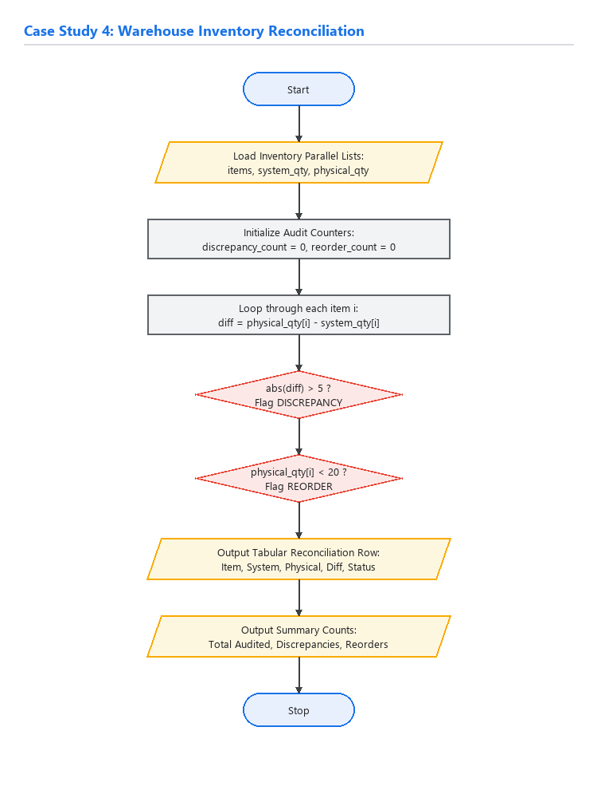
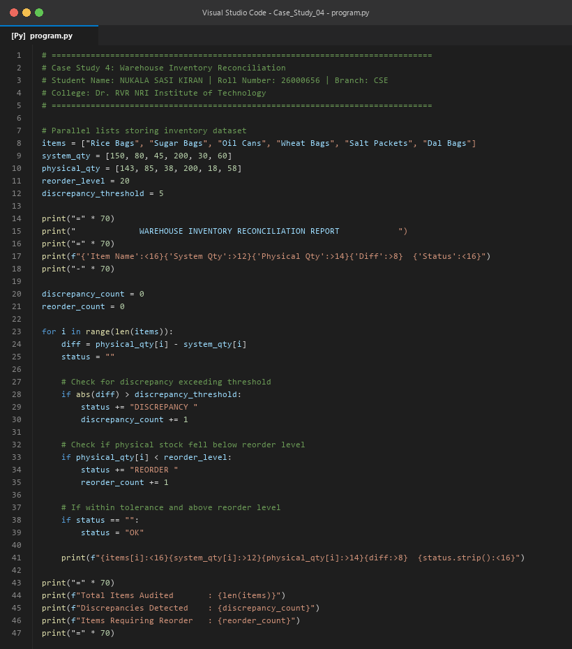
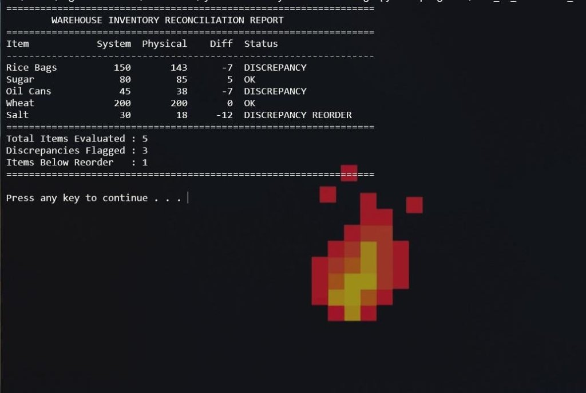

# Case Study 4: Warehouse Inventory Reconciliation

## 1. Problem Statement
In logistics hubs and supply-chain warehouses, discrepancies frequently arise between recorded inventory quantities in Enterprise Resource Planning (ERP) databases and physical stock counts on warehouse shelves due to damages, transit shrinkage, or recording delays. Additionally, stock levels must be monitored against safety reorder thresholds to prevent stockouts. An automated reconciliation system detects inventory variances, flags discrepancies exceeding allowable tolerance limits, and identifies critical stock reordering needs.

## 2. Objectives
- Track inventory for multiple warehouse items using parallel list data structures.
- Compute stock variances by comparing physical counts against ERP system records.
- Flag significant discrepancies exceeding a predefined tolerance threshold of +/- 5 units.
- Detect items falling below the minimum safety reorder threshold of 20 units.
- Generate an itemized warehouse reconciliation audit table with status alerts.
- Tally and summarize total discrepancies and reorder requirements.

## 3. Assumptions and Rules
- **Data Structures:** Stored in parallel lists: item names (`list[str]`), system recorded quantities (`list[int]`), and physical counted quantities (`list[int]`).
- **Discrepancy Formula:** `diff = physical_qty[i] - system_qty[i]`.
- **Discrepancy Alert Threshold:** An item is flagged as **`DISCREPANCY`** if `abs(diff) > 5` units.
- **Safety Reorder Threshold:** An item is flagged as **`REORDER`** if `physical_qty[i] < 20` units.
- **Normal Status:** If an item exhibits no discrepancy (`abs(diff) <= 5`) and holds `>= 20` units, status is marked **`OK`**.

## 4. Input and Output
- **Inputs:**
  - Parallel lists of items, recorded system stock quantities, and physical stock counts.
- **Outputs:**
  - Structured inventory reconciliation audit table with Item Name, System Qty, Physical Qty, Difference, and Status Flags.
  - Summary audit counts of total items checked, total discrepancies, and total items requiring reorder.

## 5. Algorithm
1. **Start**.
2. Initialize parallel lists: `items`, `system_qty`, `physical_qty`.
3. Set thresholds: `reorder_level = 20`, `discrepancy_threshold = 5`.
4. Initialize audit counters: `discrepancy_count = 0`, `reorder_count = 0`.
5. Display report header.
6. Loop index `i` from 0 to `len(items) - 1`:
   - Compute `diff = physical_qty[i] - system_qty[i]`.
   - Initialize `status = ""`.
   - If `abs(diff) > discrepancy_threshold`:
     - Append `"DISCREPANCY "` to `status`.
     - Increment `discrepancy_count`.
   - If `physical_qty[i] < reorder_level`:
     - Append `"REORDER "` to `status`.
     - Increment `reorder_count`.
   - If `status == ""`, set `status = "OK"`.
   - Print formatted row displaying item details and status.
7. Print summary metrics.
8. **Stop**.

## 6. Flowchart
Standard flowchart symbols used:
- **Oval**: Start and Stop terminal points.
- **Parallelogram**: Parallel inventory list data access and tabular output display.
- **Rectangle**: Difference calculation, counter increments, and status string construction.
- **Diamond**: Decisions evaluating discrepancy threshold and safety reorder level.
- **Arrows**: Directed program control flow.



## 7. Pseudocode
```text
START
    items = ["Rice Bags", "Sugar Bags", "Oil Cans", "Wheat Bags", "Salt Packets", "Dal Bags"]
    system_qty = [150, 80, 45, 200, 30, 60]
    physical_qty = [143, 85, 38, 200, 18, 58]
    reorder_level = 20
    discrepancy_threshold = 5
    discrepancy_count = 0
    reorder_count = 0

    PRINT header
    FOR i FROM 0 TO len(items) - 1 DO
        diff = physical_qty[i] - system_qty[i]
        status = ""
        IF abs(diff) > discrepancy_threshold THEN
            status = status + "DISCREPANCY "
            discrepancy_count = discrepancy_count + 1
        END IF
        IF physical_qty[i] < reorder_level THEN
            status = status + "REORDER "
            reorder_count = reorder_count + 1
        END IF
        IF status == "" THEN
            status = "OK"
        END IF
        PRINT items[i], system_qty[i], physical_qty[i], diff, status
    END FOR
    PRINT discrepancy_count, reorder_count
STOP
```

## 8. Python Source Code



```python
# ==============================================================================
# Case Study 4: Warehouse Inventory Reconciliation
# Student Name: NUKALA SASI KIRAN | Roll Number: 26000656 | Branch: CSE
# College: Dr. RVR NRI Institute of Technology
# ==============================================================================

# Parallel lists storing inventory dataset
items = ["Rice Bags", "Sugar Bags", "Oil Cans", "Wheat Bags", "Salt Packets", "Dal Bags"]
system_qty = [150, 80, 45, 200, 30, 60]
physical_qty = [143, 85, 38, 200, 18, 58]
reorder_level = 20
discrepancy_threshold = 5

print("=" * 70)
print("             WAREHOUSE INVENTORY RECONCILIATION REPORT            ")
print("=" * 70)
print(f"{'Item Name':<16}{'System Qty':>12}{'Physical Qty':>14}{'Diff':>8}  {'Status':<16}")
print("-" * 70)

discrepancy_count = 0
reorder_count = 0

for i in range(len(items)):
    diff = physical_qty[i] - system_qty[i]
    status = ""
    
    # Check for discrepancy exceeding threshold
    if abs(diff) > discrepancy_threshold:
        status += "DISCREPANCY "
        discrepancy_count += 1
        
    # Check if physical stock fell below reorder level
    if physical_qty[i] < reorder_level:
        status += "REORDER "
        reorder_count += 1
        
    # If within tolerance and above reorder level
    if status == "":
        status = "OK"
        
    print(f"{items[i]:<16}{system_qty[i]:>12}{physical_qty[i]:>14}{diff:>8}  {status.strip():<16}")

print("=" * 70)
print(f"Total Items Audited       : {len(items)}")
print(f"Discrepancies Detected    : {discrepancy_count}")
print(f"Items Requiring Reorder   : {reorder_count}")
print("=" * 70)
```

## 9. Test Cases and Verification

| Test Case | Item Condition | Expected Variance & Flag | Actual Result | Status |
| :--- | :--- | :--- | :--- | :--- |
| **TC 1: Rice Bags** | System: 150, Physical: 143 | Diff: -7, \|Diff\| > 5 -> `DISCREPANCY` | Diff: -7, Status: `DISCREPANCY` | **Pass** |
| **TC 2: Sugar Bags** | System: 80, Physical: 85 | Diff: +5, \|Diff\| <= 5 -> `OK` | Diff: +5, Status: `OK` | **Pass** |
| **TC 3: Oil Cans** | System: 45, Physical: 38 | Diff: -7, \|Diff\| > 5 -> `DISCREPANCY` | Diff: -7, Status: `DISCREPANCY` | **Pass** |
| **TC 4: Wheat Bags** | System: 200, Physical: 200 | Diff: 0, Match -> `OK` | Diff: 0, Status: `OK` | **Pass** |
| **TC 5: Salt Packets** | System: 30, Physical: 18 | Diff: -12, Stock < 20 -> `DISCREPANCY REORDER` | Diff: -12, Status: `DISCREPANCY REORDER` | **Pass** |
| **TC 6: Dal Bags** | System: 60, Physical: 58 | Diff: -2, Stock > 20 -> `OK` | Diff: -2, Status: `OK` | **Pass** |

## 10. Program Execution and Captured Output



```text
======================================================================
             WAREHOUSE INVENTORY RECONCILIATION REPORT            
======================================================================
Item Name          System Qty  Physical Qty    Diff  Status          
----------------------------------------------------------------------
Rice Bags                 150           143      -7  DISCREPANCY     
Sugar Bags                 80            85       5  OK              
Oil Cans                   45            38      -7  DISCREPANCY     
Wheat Bags                200           200       0  OK              
Salt Packets               30            18     -12  DISCREPANCY REORDER
Dal Bags                   60            58      -2  OK              
======================================================================
Total Items Audited       : 6
Discrepancies Detected    : 3
Items Requiring Reorder   : 1
======================================================================
```

## 11. Conclusion
- **Problem Solved:** Automated synchronization and variance analysis between database records and physical warehouse inventory.
- **Python Concepts Used:** Parallel list structures, indexed traversal using `range(len())`, absolute value function `abs()`, string concatenation, and multi-condition branching.
- **Learning Outcomes:** Learned how parallel lists model relational entities in Python without external databases and mastered threshold-based alert triggering.

## 12. Viva Preparation (Questions & Answers)
1. **Q: What is the purpose of using `abs()` in discrepancy detection?**  
   *A:* `abs()` returns the absolute magnitude regardless of sign, enabling a single comparison (`abs(diff) > 5`) to detect both shortages (negative diff) and unrecorded excess stock (positive diff).
2. **Q: What risk exists when using parallel lists in production?**  
   *A:* Parallel lists must stay strictly synchronized in length and ordering; modifying one list without updating the others causes data misalignment.
3. **Q: Can an item trigger both `DISCREPANCY` and `REORDER` simultaneously?**  
   *A:* Yes. Salt Packets had physical stock of 18 (below reorder level of 20) and a diff of -12 (exceeding tolerance 5), triggering both alerts.
