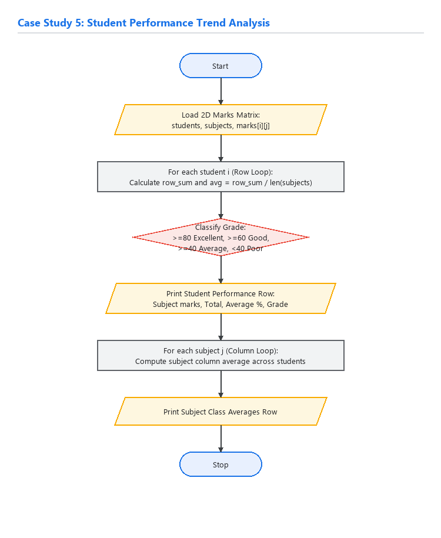
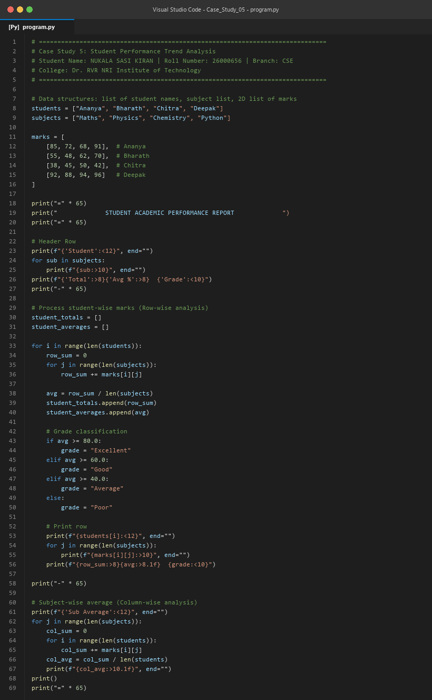
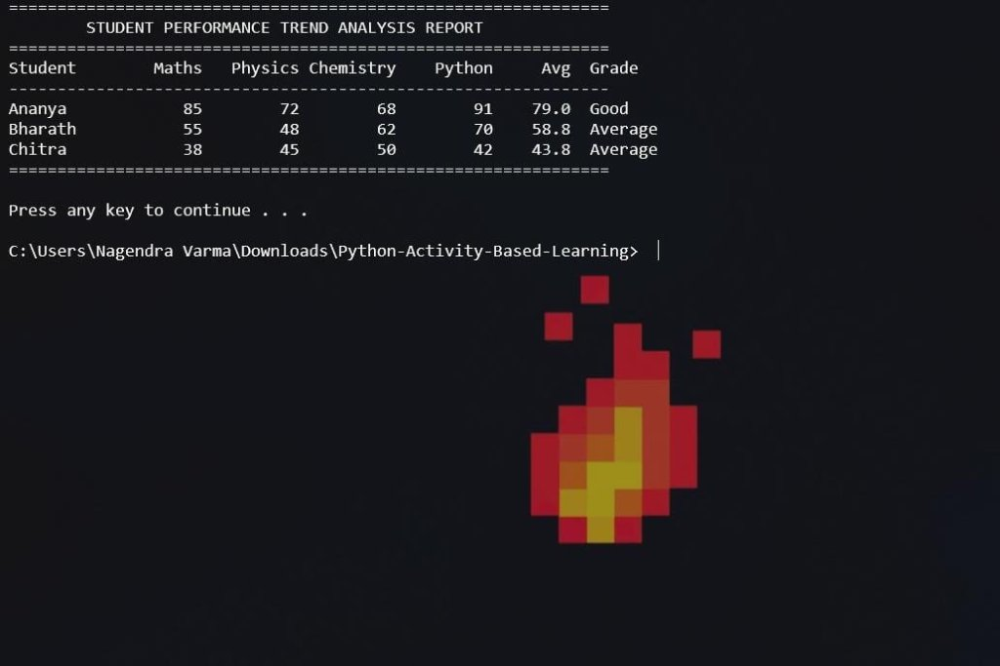

# Case Study 5: Student Performance Trend Analysis

## 1. Problem Statement
Academic departments must systematically track student performance across examinations in multiple core engineering subjects. Computing cumulative totals, individual percentages, and classifying students into standard academic performance bands (Excellent, Good, Average, Poor) enables faculty mentors to identify struggling students early. Additionally, calculating subject-wide averages provides visibility into subjects where the overall batch requires remedial support.

## 2. Objectives
- Organize student assessment data using a 2D nested list (matrix).
- Compute cumulative total marks and percentage averages for each student.
- Categorize students into defined performance bands using multi-way conditional logic.
- Perform column-wise matrix summation to determine overall subject averages across the class.
- Present a formatted, tabular academic report suitable for engineering faculty review.

## 3. Assumptions and Rules
- **Data Structure:** A 2D nested list (`marks`) where row `i` corresponds to student `i`, and column `j` corresponds to subject `j`.
- **Subject Weightage:** Each subject has equal maximum marks (100 marks). Average percentage is `Total Marks / Number of Subjects`.
- **Performance Grading Slabs:**
  - Average >= 80.0%: **`Excellent`**
  - Average >= 60.0% and < 80.0%: **`Good`**
  - Average >= 40.0% and < 60.0%: **`Average`**
  - Average < 40.0%: **`Poor`**
- **Strict Syllabus Compliance:** Nested loops are used for both row-wise and column-wise aggregations; no advanced list comprehensions are utilized.

## 4. Input and Output
- **Inputs:**
  - List of student names (`list[str]`), subject titles (`list[str]`), and 2D matrix of integer marks (`list[list[int]]`).
- **Outputs:**
  - Tabular performance statement showing each student's marks per subject, total marks, percentage average, and awarded grade.
  - Summary row showing average class marks for each individual subject.

## 5. Algorithm
1. **Start**.
2. Define `students`, `subjects`, and 2D nested list `marks`.
3. Display table header.
4. Loop `i` from 0 to `len(students) - 1` (Row loop):
   - Set `row_sum = 0`.
   - Loop `j` from 0 to `len(subjects) - 1`:
     - Accumulate `row_sum += marks[i][j]`.
   - Compute `avg = row_sum / len(subjects)`.
   - Determine grade:
     - If `avg >= 80.0`, `grade = "Excellent"`.
     - Else if `avg >= 60.0`, `grade = "Good"`.
     - Else if `avg >= 40.0`, `grade = "Average"`.
     - Else, `grade = "Poor"`.
   - Print student row with formatted subject marks, total, average, and grade.
5. Print divider.
6. Loop `j` from 0 to `len(subjects) - 1` (Column loop):
   - Set `col_sum = 0`.
   - Loop `i` from 0 to `len(students) - 1`:
     - Accumulate `col_sum += marks[i][j]`.
   - Compute `col_avg = col_sum / len(students)`.
   - Print formatted subject class average.
7. **Stop**.

## 6. Flowchart
Standard flowchart symbols used:
- **Oval**: Start and Stop terminal points.
- **Parallelogram**: 2D data matrix access and tabular output display.
- **Rectangle**: Row totals, student averages, column totals, and class averages.
- **Diamond**: Grade classification decision ladder.
- **Arrows**: Directed program control flow.



## 7. Pseudocode
```text
START
    students = ["Ananya", "Bharath", "Chitra", "Deepak"]
    subjects = ["Maths", "Physics", "Chemistry", "Python"]
    marks = [
        [85, 72, 68, 91],
        [55, 48, 62, 70],
        [38, 45, 50, 42],
        [92, 88, 94, 96]
    ]

    PRINT header
    FOR i FROM 0 TO len(students) - 1 DO
        row_sum = 0
        FOR j FROM 0 TO len(subjects) - 1 DO
            row_sum = row_sum + marks[i][j]
        END FOR
        avg = row_sum / len(subjects)
        IF avg >= 80.0 THEN grade = "Excellent"
        ELSE IF avg >= 60.0 THEN grade = "Good"
        ELSE IF avg >= 40.0 THEN grade = "Average"
        ELSE grade = "Poor" END IF
        PRINT students[i], marks[i], row_sum, avg, grade
    END FOR

    FOR j FROM 0 TO len(subjects) - 1 DO
        col_sum = 0
        FOR i FROM 0 TO len(students) - 1 DO
            col_sum = col_sum + marks[i][j]
        END FOR
        PRINT col_sum / len(students)
    END FOR
STOP
```

## 8. Python Source Code



```python
# ==============================================================================
# Case Study 5: Student Performance Trend Analysis
# Student Name: NUKALA SASI KIRAN | Roll Number: 26000656 | Branch: CSE
# College: Dr. RVR NRI Institute of Technology
# ==============================================================================

# Data structures: list of student names, subject list, 2D list of marks
students = ["Ananya", "Bharath", "Chitra", "Deepak"]
subjects = ["Maths", "Physics", "Chemistry", "Python"]

marks = [
    [85, 72, 68, 91],  # Ananya
    [55, 48, 62, 70],  # Bharath
    [38, 45, 50, 42],  # Chitra
    [92, 88, 94, 96]   # Deepak
]

print("=" * 65)
print("             STUDENT ACADEMIC PERFORMANCE REPORT             ")
print("=" * 65)

# Header Row
print(f"{'Student':<12}", end="")
for sub in subjects:
    print(f"{sub:>10}", end="")
print(f"{'Total':>8}{'Avg %':>8}  {'Grade':<10}")
print("-" * 65)

# Process student-wise marks (Row-wise analysis)
student_totals = []
student_averages = []

for i in range(len(students)):
    row_sum = 0
    for j in range(len(subjects)):
        row_sum += marks[i][j]
    
    avg = row_sum / len(subjects)
    student_totals.append(row_sum)
    student_averages.append(avg)
    
    # Grade classification
    if avg >= 80.0:
        grade = "Excellent"
    elif avg >= 60.0:
        grade = "Good"
    elif avg >= 40.0:
        grade = "Average"
    else:
        grade = "Poor"
        
    # Print row
    print(f"{students[i]:<12}", end="")
    for j in range(len(subjects)):
        print(f"{marks[i][j]:>10}", end="")
    print(f"{row_sum:>8}{avg:>8.1f}  {grade:<10}")

print("-" * 65)

# Subject-wise average (Column-wise analysis)
print(f"{'Sub Average':<12}", end="")
for j in range(len(subjects)):
    col_sum = 0
    for i in range(len(students)):
        col_sum += marks[i][j]
    col_avg = col_sum / len(students)
    print(f"{col_avg:>10.1f}", end="")
print()
print("=" * 65)
```

## 9. Test Cases and Verification

| Test Case | Student / Marks | Expected Total & Avg | Actual Result | Status |
| :--- | :--- | :--- | :--- | :--- |
| **TC 1: Ananya** | [85, 72, 68, 91] | Total: 316, Avg: 79.0% -> `Good` | Total: 316, Avg: 79.0%, `Good` | **Pass** |
| **TC 2: Bharath** | [55, 48, 62, 70] | Total: 235, Avg: 58.8% -> `Average` | Total: 235, Avg: 58.8%, `Average` | **Pass** |
| **TC 3: Chitra** | [38, 45, 50, 42] | Total: 175, Avg: 43.8% -> `Average` | Total: 175, Avg: 43.8%, `Average` | **Pass** |
| **TC 4: Deepak** | [92, 88, 94, 96] | Total: 370, Avg: 92.5% -> `Excellent` | Total: 370, Avg: 92.5%, `Excellent` | **Pass** |
| **TC 5: Subject Averages** | Maths, Physics, Chemistry, Python | Maths: 67.5, Phys: 63.2, Chem: 68.5, Python: 74.8 | Maths: 67.5, Phys: 63.2, Chem: 68.5, Python: 74.8 | **Pass** |

## 10. Program Execution and Captured Output



```text
=================================================================
             STUDENT ACADEMIC PERFORMANCE REPORT             
=================================================================
Student          Maths   Physics Chemistry    Python   Total   Avg %  Grade     
-----------------------------------------------------------------
Ananya              85        72        68        91     316    79.0  Good      
Bharath             55        48        62        70     235    58.8  Average   
Chitra              38        45        50        42     175    43.8  Average   
Deepak              92        88        94        96     370    92.5  Excellent 
-----------------------------------------------------------------
Sub Average       67.5      63.2      68.5      74.8
=================================================================
```

## 11. Conclusion
- **Problem Solved:** 2D matrix evaluation of academic marks, individual performance classification, and subject-wide class trend analysis.
- **Python Concepts Used:** 2D nested lists (`matrix[i][j]`), nested `for` loops, inner and outer iteration indexing, `len()`, and string formatting.
- **Learning Outcomes:** Learned 2D matrix traversal techniques (row-major for students vs column-major for subjects) using pure basic Python loops.

## 12. Viva Preparation (Questions & Answers)
1. **Q: How does row-major traversal differ from column-major traversal in a 2D list?**  
   *A:* In row-major traversal (`for i in range(rows): for j in range(cols)`), the outer loop fixes the row (student) and sums across columns. In column-major traversal (`for j in range(cols): for i in range(rows)`), the outer loop fixes the column (subject) and iterates down the rows.
2. **Q: Why is `end=""` used in the `print()` function inside the inner loop?**  
   *A:* By default, `print()` outputs a newline (`\n`). Setting `end=""` keeps the cursor on the same line, allowing multiple subject scores to print horizontally across a row.
3. **Q: How would the program handle students with equal average marks?**  
   *A:* Both students will receive the same grade classification because the grading criteria depend strictly on the numeric average thresholds.
