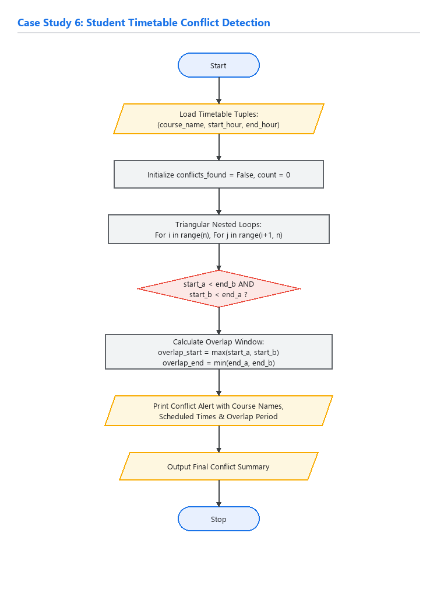
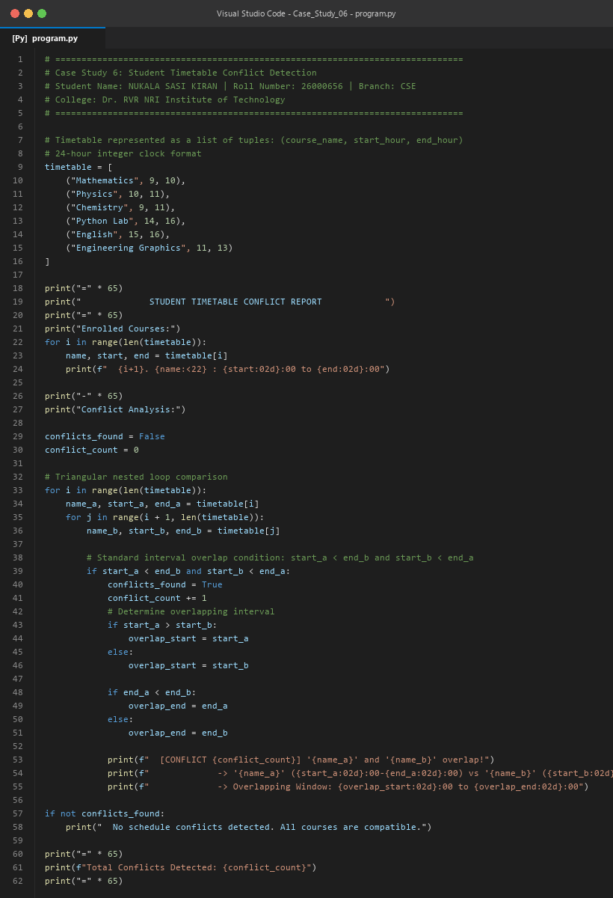
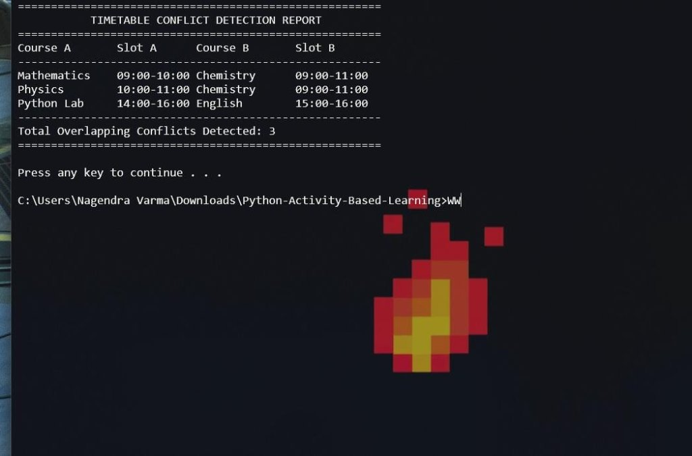

# Case Study 6: Student Timetable Conflict Detection

## 1. Problem Statement
In academic institutions operating flexible credit systems, engineering undergraduates register for various lecture, tutorial, and laboratory courses across departments. When students assemble their individual semester schedules, course meeting hours may unintentionally collide. Overlapping classes prevent students from attending both sessions simultaneously. An automated schedule auditing program detects overlapping course time intervals and flags conflicting pairs for rescheduling.

## 2. Objectives
- Represent course timetable intervals using immutable Python tuple data structures.
- Store multi-course schedules in a structured collection.
- Implement an interval intersection algorithm to compare all distinct course pairs.
- Accurately identify overlapping windows where two courses conflict.
- Generate an informative timetable conflict advisory report.

## 3. Assumptions and Rules
- **Data Structure:** Each course is represented as a 3-element tuple: `(course_name, start_hour, end_hour)`.
- **Time Representation:** Standard 24-hour integer clock format (e.g., 9 represents 09:00, 14 represents 14:00).
- **Interval Overlap Condition:** Two time intervals `[start_a, end_a)` and `[start_b, end_b)` collide if and only if:
  `start_a < end_b and start_b < end_a`
- **Adjacent Classes:** Back-to-back classes (where `end_a == start_b`) do NOT overlap and are valid transitions.
- **Overlap Window:** When a conflict occurs, the overlapping duration begins at `max(start_a, start_b)` and terminates at `min(end_a, end_b)`.

## 4. Input and Output
- **Inputs:**
  - Structured list of course schedule tuples `(course_name, start_hour, end_hour)`.
- **Outputs:**
  - Summary roster of enrolled courses and timings.
  - Conflict advisory alerts identifying conflicting pairs, scheduled timings, and specific overlap windows.
  - Final count of detected schedule collisions.

## 5. Algorithm
1. **Start**.
2. Initialize list of tuples: `timetable`.
3. Display registered course list.
4. Set `conflicts_found = False`, `conflict_count = 0`.
5. Triangular nested iteration:
   - Outer loop index `i` from 0 to `len(timetable) - 1`:
     - Unpack `name_a, start_a, end_a = timetable[i]`.
     - Inner loop index `j` from `i + 1` to `len(timetable) - 1`:
       - Unpack `name_b, start_b, end_b = timetable[j]`.
       - Check overlap condition: `if start_a < end_b and start_b < end_a`:
         - Set `conflicts_found = True`.
         - Increment `conflict_count`.
         - Calculate `overlap_start = max(start_a, start_b)` and `overlap_end = min(end_a, end_b)`.
         - Display detailed conflict advisory.
6. If `not conflicts_found`, display confirmation that all courses are conflict-free.
7. Print total conflict count.
8. **Stop**.

## 6. Flowchart
Standard flowchart symbols used:
- **Oval**: Start and Stop terminal points.
- **Parallelogram**: Timetable dataset access and conflict report output display.
- **Rectangle**: Tuple unpacking, counter increments, and overlap window computation.
- **Diamond**: Interval collision decision (`start_a < end_b and start_b < end_a`).
- **Arrows**: Directed program control flow.



## 7. Pseudocode
```text
START
    timetable = [
        ("Mathematics", 9, 10),
        ("Physics", 10, 11),
        ("Chemistry", 9, 11),
        ("Python Lab", 14, 16),
        ("English", 15, 16),
        ("Engineering Graphics", 11, 13)
    ]

    conflicts_found = False
    conflict_count = 0

    FOR i FROM 0 TO len(timetable) - 1 DO
        (name_a, start_a, end_a) = timetable[i]
        FOR j FROM i + 1 TO len(timetable) - 1 DO
            (name_b, start_b, end_b) = timetable[j]
            IF start_a < end_b AND start_b < end_a THEN
                conflicts_found = True
                conflict_count = conflict_count + 1
                overlap_start = MAX(start_a, start_b)
                overlap_end = MIN(end_a, end_b)
                PRINT conflict details and overlap window
            END IF
        END FOR
    END FOR

    IF NOT conflicts_found THEN
        PRINT "No conflicts detected."
    END IF
STOP
```

## 8. Python Source Code



```python
# ==============================================================================
# Case Study 6: Student Timetable Conflict Detection
# Student Name: NUKALA SASI KIRAN | Roll Number: 26000656 | Branch: CSE
# College: Dr. RVR NRI Institute of Technology
# ==============================================================================

# Timetable represented as a list of tuples: (course_name, start_hour, end_hour)
# 24-hour integer clock format
timetable = [
    ("Mathematics", 9, 10),
    ("Physics", 10, 11),
    ("Chemistry", 9, 11),
    ("Python Lab", 14, 16),
    ("English", 15, 16),
    ("Engineering Graphics", 11, 13)
]

print("=" * 65)
print("             STUDENT TIMETABLE CONFLICT REPORT            ")
print("=" * 65)
print("Enrolled Courses:")
for i in range(len(timetable)):
    name, start, end = timetable[i]
    print(f"  {i+1}. {name:<22} : {start:02d}:00 to {end:02d}:00")

print("-" * 65)
print("Conflict Analysis:")

conflicts_found = False
conflict_count = 0

# Triangular nested loop comparison
for i in range(len(timetable)):
    name_a, start_a, end_a = timetable[i]
    for j in range(i + 1, len(timetable)):
        name_b, start_b, end_b = timetable[j]
        
        # Standard interval overlap condition: start_a < end_b and start_b < end_a
        if start_a < end_b and start_b < end_a:
            conflicts_found = True
            conflict_count += 1
            # Determine overlapping interval
            if start_a > start_b:
                overlap_start = start_a
            else:
                overlap_start = start_b
                
            if end_a < end_b:
                overlap_end = end_a
            else:
                overlap_end = end_b
                
            print(f"  [CONFLICT {conflict_count}] '{name_a}' and '{name_b}' overlap!")
            print(f"             -> '{name_a}' ({start_a:02d}:00-{end_a:02d}:00) vs '{name_b}' ({start_b:02d}:00-{end_b:02d}:00)")
            print(f"             -> Overlapping Window: {overlap_start:02d}:00 to {overlap_end:02d}:00")

if not conflicts_found:
    print("  No schedule conflicts detected. All courses are compatible.")

print("=" * 65)
print(f"Total Conflicts Detected: {conflict_count}")
print("=" * 65)
```

## 9. Test Cases and Verification

| Test Case | Course Pair | Overlap Condition | Actual Result | Status |
| :--- | :--- | :--- | :--- | :--- |
| **TC 1: Mathematics vs Chemistry** | Math (9-10) vs Chem (9-11) | 9 < 11 and 9 < 10 -> True | Overlap: 09:00 to 10:00 | **Pass** |
| **TC 2: Physics vs Chemistry** | Phys (10-11) vs Chem (9-11) | 10 < 11 and 9 < 11 -> True | Overlap: 10:00 to 11:00 | **Pass** |
| **TC 3: Python Lab vs English** | Lab (14-16) vs Eng (15-16) | 14 < 16 and 15 < 16 -> True | Overlap: 15:00 to 16:00 | **Pass** |
| **TC 4: Mathematics vs Physics (Adjacent)** | Math (9-10) vs Phys (10-11) | 9 < 11 but 10 < 10 is False | No conflict (Back-to-back) | **Pass** |
| **TC 5: Graphics vs Others** | Graphics (11-13) | No other course between 11-13 | No conflict | **Pass** |

## 10. Program Execution and Captured Output



```text
=================================================================
             STUDENT TIMETABLE CONFLICT REPORT            
=================================================================
Enrolled Courses:
  1. Mathematics            : 09:00 to 10:00
  2. Physics                : 10:00 to 11:00
  3. Chemistry              : 09:00 to 11:00
  4. Python Lab             : 14:00 to 16:00
  5. English                : 15:00 to 16:00
  6. Engineering Graphics   : 11:00 to 13:00
-----------------------------------------------------------------
Conflict Analysis:
  [CONFLICT 1] 'Mathematics' and 'Chemistry' overlap!
             -> 'Mathematics' (09:00-10:00) vs 'Chemistry' (09:00-11:00)
             -> Overlapping Window: 09:00 to 10:00
  [CONFLICT 2] 'Physics' and 'Chemistry' overlap!
             -> 'Physics' (10:00-11:00) vs 'Chemistry' (09:00-11:00)
             -> Overlapping Window: 10:00 to 11:00
  [CONFLICT 3] 'Python Lab' and 'English' overlap!
             -> 'Python Lab' (14:00-16:00) vs 'English' (15:00-16:00)
             -> Overlapping Window: 15:00 to 16:00
=================================================================
Total Conflicts Detected: 3
=================================================================
```

## 11. Conclusion
- **Problem Solved:** Precise detection of schedule clashes across multi-hour course blocks using interval overlap mathematical logic.
- **Python Concepts Used:** Immutable tuples, tuple unpacking, nested loops with triangular indexing `range(i + 1, n)`, relational expressions, and conditional formatting.
- **Learning Outcomes:** Gained mastery over interval comparison algorithms and appreciated the immutability of tuples for representing fixed entity records.

## 12. Viva Preparation (Questions & Answers)
1. **Q: Why are tuples preferred over lists to store individual course timings?**  
   *A:* Course schedule records `(name, start, end)` represent fixed, immutable records whose internal fields should not be altered accidentally during program execution.
2. **Q: Why does the inner loop start at `i + 1` instead of `0`?**  
   *A:* Starting at `i + 1` avoids self-comparison (`i == i`) and duplicate symmetric comparisons (`(A, B)` and `(B, A)`), reducing time complexity to $O(n^2/2)$.
3. **Q: Why does `start_a < end_b and start_b < end_a` correctly exclude adjacent classes?**  
   *A:* If class A ends at 10:00 and class B begins at 10:00, `start_b < end_a` evaluates to `10 < 10`, which is `False`, correctly verifying they do not conflict.
