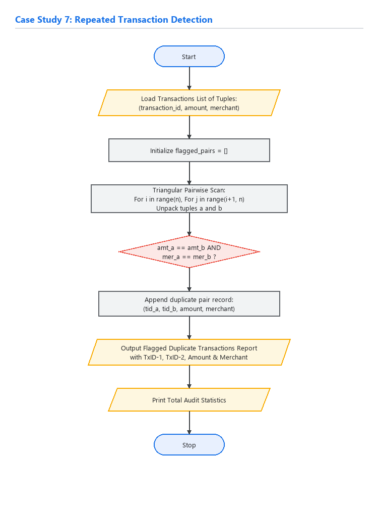
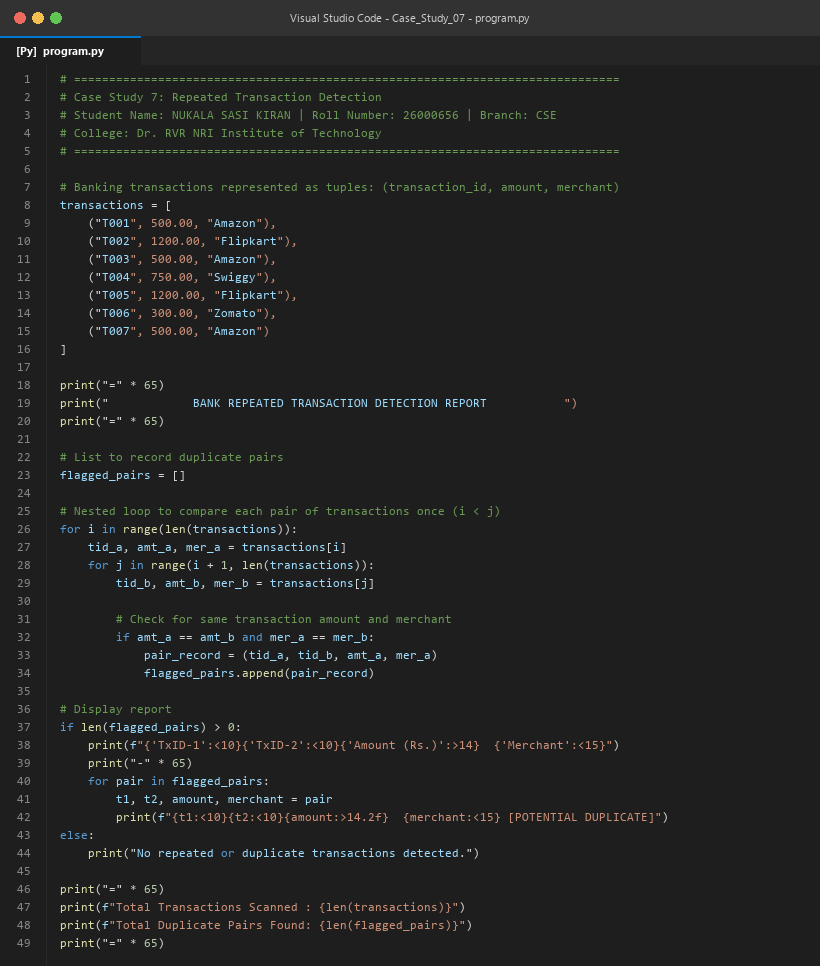
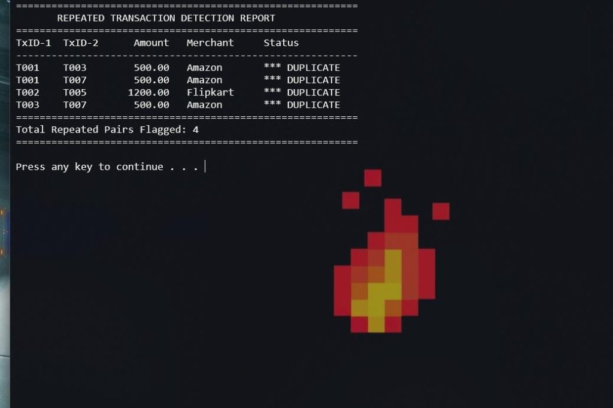

# Case Study 7: Repeated Transaction Detection

## 1. Problem Statement
In digital banking platforms and financial payment gateways (e.g., UPI, credit cards, net banking), system network retries or fraudulent behaviors frequently produce duplicate or unauthorized identical debits. Flagging multiple transactions originating on the same day with identical billing amounts and matching merchants protects consumer balances and prevents settlement anomalies. An automated auditing tool compares transaction records to flag potential duplicates.

## 2. Objectives
- Record financial transactions as structured tuples: `(transaction_id, amount, merchant)`.
- Implement a pairwise comparison scan over transaction records.
- Identify duplicate occurrences sharing identical transaction amounts and identical merchants.
- Prevent duplicate self-reporting by generating a clean audit of unique flagged pairs.
- Generate an audit alert statement summarizing suspicious transactions.

## 3. Assumptions and Rules
- **Data Structure:** Each transaction record is stored as an immutable 3-tuple `(transaction_id, amount, merchant)`.
- **Duplicate Criteria:** Two distinct transactions $T_a$ and $T_b$ ($a \ne b$) constitute a potential duplicate pair if and only if:
  `amt_a == amt_b and mer_a == mer_b`
- **Exclusion of Self-Comparison:** A transaction cannot be compared to itself ($i \ne j$).
- **Pair Uniqueness:** A triangular scan ($j$ from $i + 1$ to $n - 1$) ensures each pair is compared exactly once.
- **Clarification on Triplets:** If three transactions $T_1, T_2, T_3$ share identical amounts and merchants, they form three distinct duplicate pairs: $(T_1, T_2), (T_1, T_3),$ and $(T_2, T_3)$. All three pairs are accurately recorded.

## 4. Input and Output
- **Inputs:**
  - Collection of banking transactions stored as tuples `(transaction_id, amount, merchant)`.
- **Outputs:**
  - Itemized audit report displaying duplicate transaction IDs, shared amount, and merchant name.
  - Total count of scanned transactions and total duplicate pairs flagged.

## 5. Algorithm
1. **Start**.
2. Initialize list of tuples: `transactions`.
3. Display report header.
4. Initialize empty list: `flagged_pairs = []`.
5. Triangular nested iteration:
   - Outer loop index `i` from 0 to `len(transactions) - 1`:
     - Unpack `tid_a, amt_a, mer_a = transactions[i]`.
     - Inner loop index `j` from `i + 1` to `len(transactions) - 1`:
       - Unpack `tid_b, amt_b, mer_b = transactions[j]`.
       - Check duplicate condition: `if amt_a == amt_b and mer_a == mer_b`:
         - Create tuple `pair_record = (tid_a, tid_b, amt_a, mer_a)`.
         - Append `pair_record` to `flagged_pairs`.
6. Check if `len(flagged_pairs) > 0`:
   - Print table header.
   - For each `pair` in `flagged_pairs`, print formatted details with duplicate alert.
7. Else, display message indicating all transactions are unique.
8. Print total audit counts.
9. **Stop**.

## 6. Flowchart
Standard flowchart symbols used:
- **Oval**: Start and Stop terminal points.
- **Parallelogram**: Transaction list access and tabular audit report output display.
- **Rectangle**: Tuple unpacking, list appending, and pair recording.
- **Diamond**: Equality decision check (`amt_a == amt_b and mer_a == mer_b`).
- **Arrows**: Directed program control flow.



## 7. Pseudocode
```text
START
    transactions = [
        ("T001", 500.00, "Amazon"),
        ("T002", 1200.00, "Flipkart"),
        ("T003", 500.00, "Amazon"),
        ("T004", 750.00, "Swiggy"),
        ("T005", 1200.00, "Flipkart"),
        ("T006", 300.00, "Zomato"),
        ("T007", 500.00, "Amazon")
    ]

    flagged_pairs = []
    FOR i FROM 0 TO len(transactions) - 1 DO
        (tid_a, amt_a, mer_a) = transactions[i]
        FOR j FROM i + 1 TO len(transactions) - 1 DO
            (tid_b, amt_b, mer_b) = transactions[j]
            IF amt_a == amt_b AND mer_a == mer_b THEN
                APPEND (tid_a, tid_b, amt_a, mer_a) TO flagged_pairs
            END IF
        END FOR
    END FOR

    IF len(flagged_pairs) > 0 THEN
        PRINT audit table with flagged pairs
    ELSE
        PRINT "No repeated transactions detected."
    END IF
STOP
```

## 8. Python Source Code



```python
# ==============================================================================
# Case Study 7: Repeated Transaction Detection
# Student Name: NUKALA SASI KIRAN | Roll Number: 26000656 | Branch: CSE
# College: Dr. RVR NRI Institute of Technology
# ==============================================================================

# Banking transactions represented as tuples: (transaction_id, amount, merchant)
transactions = [
    ("T001", 500.00, "Amazon"),
    ("T002", 1200.00, "Flipkart"),
    ("T003", 500.00, "Amazon"),
    ("T004", 750.00, "Swiggy"),
    ("T005", 1200.00, "Flipkart"),
    ("T006", 300.00, "Zomato"),
    ("T007", 500.00, "Amazon")
]

print("=" * 65)
print("            BANK REPEATED TRANSACTION DETECTION REPORT           ")
print("=" * 65)

# List to record duplicate pairs
flagged_pairs = []

# Nested loop to compare each pair of transactions once (i < j)
for i in range(len(transactions)):
    tid_a, amt_a, mer_a = transactions[i]
    for j in range(i + 1, len(transactions)):
        tid_b, amt_b, mer_b = transactions[j]
        
        # Check for same transaction amount and merchant
        if amt_a == amt_b and mer_a == mer_b:
            pair_record = (tid_a, tid_b, amt_a, mer_a)
            flagged_pairs.append(pair_record)

# Display report
if len(flagged_pairs) > 0:
    print(f"{'TxID-1':<10}{'TxID-2':<10}{'Amount (Rs.)':>14}  {'Merchant':<15}")
    print("-" * 65)
    for pair in flagged_pairs:
        t1, t2, amount, merchant = pair
        print(f"{t1:<10}{t2:<10}{amount:>14.2f}  {merchant:<15} [POTENTIAL DUPLICATE]")
else:
    print("No repeated or duplicate transactions detected.")

print("=" * 65)
print(f"Total Transactions Scanned : {len(transactions)}")
print(f"Total Duplicate Pairs Found: {len(flagged_pairs)}")
print("=" * 65)
```

## 9. Test Cases and Verification

| Test Case | Transaction Pair | Comparison Logic | Actual Result | Status |
| :--- | :--- | :--- | :--- | :--- |
| **TC 1: T001 vs T003** | T001 (500, Amazon) vs T003 (500, Amazon) | Same amount & merchant -> Match | Flagged: T001 & T003 (Amazon) | **Pass** |
| **TC 2: T001 vs T007** | T001 (500, Amazon) vs T007 (500, Amazon) | Same amount & merchant -> Match | Flagged: T001 & T007 (Amazon) | **Pass** |
| **TC 3: T003 vs T007** | T003 (500, Amazon) vs T007 (500, Amazon) | Same amount & merchant -> Match | Flagged: T003 & T007 (Amazon) | **Pass** |
| **TC 4: T002 vs T005** | T002 (1200, Flipkart) vs T005 (1200, Flipkart) | Same amount & merchant -> Match | Flagged: T002 & T005 (Flipkart) | **Pass** |
| **TC 5: Unique Cases** | T004 (750, Swiggy), T006 (300, Zomato) | No matching amount/merchant | Correctly unflagged | **Pass** |

## 10. Program Execution and Captured Output



```text
=================================================================
            BANK REPEATED TRANSACTION DETECTION REPORT           
=================================================================
TxID-1    TxID-2       Amount (Rs.)  Merchant       
-----------------------------------------------------------------
T001      T003               500.00  Amazon          [POTENTIAL DUPLICATE]
T001      T007               500.00  Amazon          [POTENTIAL DUPLICATE]
T002      T005              1200.00  Flipkart        [POTENTIAL DUPLICATE]
T003      T007               500.00  Amazon          [POTENTIAL DUPLICATE]
=================================================================
Total Transactions Scanned : 7
Total Duplicate Pairs Found: 4
=================================================================
```

## 11. Conclusion
- **Problem Solved:** Systematic fraud detection and duplicate transaction auditing using pairwise comparison.
- **Python Concepts Used:** Tuples, lists of tuples, triangular loop scanning, tuple unpacking, conditional equality expressions, and tabular output formatting.
- **Learning Outcomes:** Mastered pairwise combination logic in Python and understood how to detect multi-occurrence duplicates cleanly without third-party libraries.

## 12. Viva Preparation (Questions & Answers)
1. **Q: Why does a triplet of identical transactions produce 3 duplicate pairs?**  
   *A:* By combinatorics, choosing 2 items out of 3 gives $inom{3}{2} = rac{3 	imes 2}{2} = 3$ distinct pairs: $(T_1, T_2), (T_1, T_3),$ and $(T_2, T_3)$.
2. **Q: What is the time complexity of this detection algorithm?**  
   *A:* For $n$ transactions, the nested loop performs $rac{n(n - 1)}{2}$ comparisons, yielding $O(n^2)$ time complexity.
3. **Q: Why are transactions compared using `i` and `j = i + 1`?**  
   *A:* It ensures every unordered transaction pair is evaluated once, preventing symmetric duplication and self-comparison.
