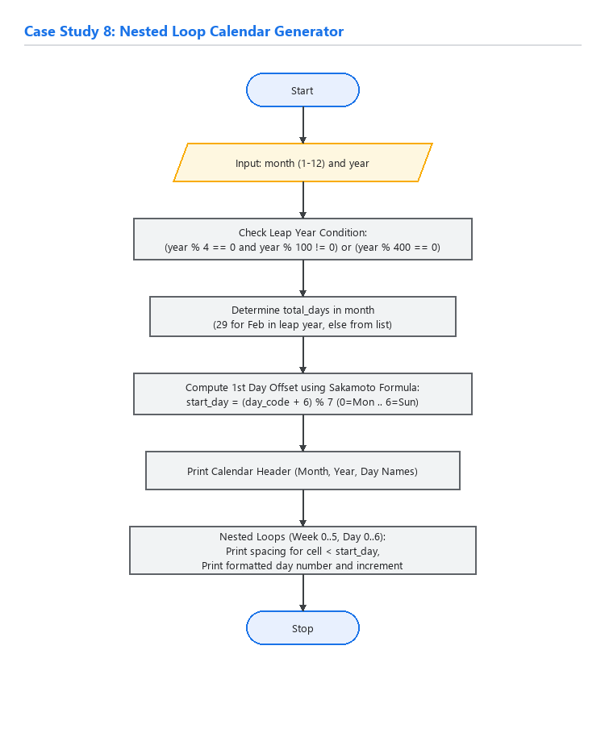
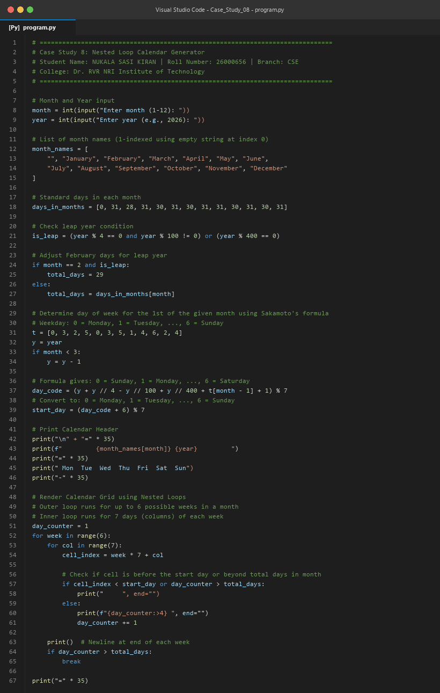
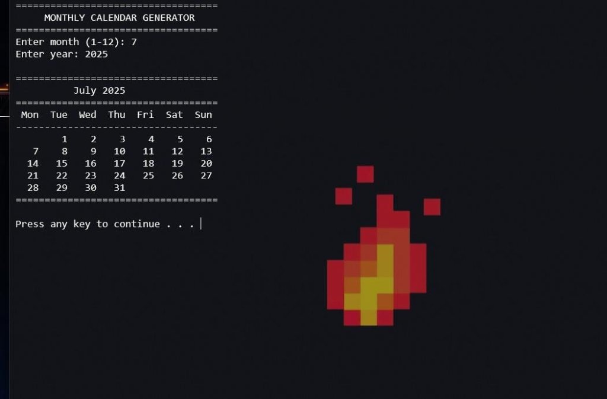

# Case Study 8: Nested Loop Calendar Generator

## 1. Problem Statement
Calendars and schedule planners display dates structured systematically across a two-dimensional 7-column grid representing the days of the week (Monday through Sunday). Generating an accurate monthly calendar requires computing the exact weekday for the first day of the month, accounting for variable days across months (including February in leap years), aligning the initial day with its correct weekday column, and wrapping days into subsequent rows. Implementing this without external calendar packages reinforces mathematical date arithmetic and nested loop grid formatting.

## 2. Objectives
- Prompt user for month (1 to 12) and 4-digit year.
- Determine whether the year is a leap year using standard conditional rules.
- Look up total days in the month (including 29 for February in leap years).
- Calculate the day of the week for the 1st day of the given month using Sakamoto's congruence algorithm.
- Render a 7-column calendar grid using nested `for` loops (weeks and days).
- Strictly adhere to first-year syllabus concepts by avoiding custom `def` functions.

## 3. Assumptions and Rules
- **Weekday Order:** Monday (0), Tuesday (1), Wednesday (2), Thursday (3), Friday (4), Saturday (5), Sunday (6).
- **Leap Year Rule:** A year is a leap year if `(year % 4 == 0 and year % 100 != 0) or (year % 400 == 0)`.
- **Month Days Array:** Days per month: `[0, 31, 28, 31, 30, 31, 30, 31, 31, 30, 31, 30, 31]`. February has 29 days during leap years.
- **Sakamoto's Day Algorithm:**
  - Adjustment array: `t = [0, 3, 2, 5, 0, 3, 5, 1, 4, 6, 2, 4]`.
  - If `month < 3`, `y = year - 1`, else `y = year`.
  - `day_code = (y + y // 4 - y // 100 + y // 400 + t[month - 1] + 1) % 7` (where 0=Sunday, 1=Monday).
  - Shifted to Monday-based indexing: `start_day = (day_code + 6) % 7`.
- **Grid Layout:** Maximum 6 weeks (rows), 7 weekdays (columns).

## 4. Input and Output
- **Inputs:**
  - Month number (`int`, 1 to 12)
  - Year (`int`, e.g., 2025, 2026)
- **Outputs:**
  - Formatted month-year title.
  - Column headers (`Mon  Tue  Wed  Thu  Fri  Sat  Sun`).
  - 2D calendar grid displaying dates properly aligned beneath weekday headers.

## 5. Algorithm
1. **Start**.
2. Read `month` and `year` as integers.
3. Define `month_names` and `days_in_months` lists.
4. Check leap year condition:
   - `is_leap = (year % 4 == 0 and year % 100 != 0) or (year % 400 == 0)`
5. If `month == 2 and is_leap`, set `total_days = 29`, else `total_days = days_in_months[month]`.
6. Calculate weekday offset for the 1st of the month:
   - If `month < 3`, set `y = year - 1`, else `y = year`.
   - Compute `day_code = (y + y // 4 - y // 100 + y // 400 + t[month - 1] + 1) % 7`.
   - Convert to Monday-start index: `start_day = (day_code + 6) % 7`.
7. Display header with month name, year, and weekday titles.
8. Initialize `day_counter = 1`.
9. Outer loop `week` from 0 to 5:
   - Inner loop `col` from 0 to 6:
     - `cell_index = week * 7 + col`.
     - If `cell_index < start_day` or `day_counter > total_days`:
       - Print empty cell spacing (`"     "`).
     - Else:
       - Print `day_counter` formatted (`f"{day_counter:>4} "`).
       - Increment `day_counter = day_counter + 1`.
   - Print newline.
   - If `day_counter > total_days`, break outer loop.
10. **Stop**.

## 6. Flowchart
Standard flowchart symbols used:
- **Oval**: Start and Stop terminal points.
- **Parallelogram**: User input for month/year and calendar grid print statements.
- **Rectangle**: Leap year evaluation, day offset arithmetic, and counter incrementation.
- **Diamond**: Decisions evaluating month 2 leap year, offset spacing, and termination conditions.
- **Arrows**: Directed program control flow.



## 7. Pseudocode
```text
START
    INPUT month, year
    days_in_months = [0, 31, 28, 31, 30, 31, 30, 31, 31, 30, 31, 30, 31]
    is_leap = (year % 4 == 0 AND year % 100 != 0) OR (year % 400 == 0)

    IF month == 2 AND is_leap THEN
        total_days = 29
    ELSE
        total_days = days_in_months[month]
    END IF

    t = [0, 3, 2, 5, 0, 3, 5, 1, 4, 6, 2, 4]
    y = year
    IF month < 3 THEN y = y - 1 END IF
    day_code = (y + y // 4 - y // 100 + y // 400 + t[month - 1] + 1) % 7
    start_day = (day_code + 6) % 7

    PRINT month_names[month], year
    PRINT " Mon  Tue  Wed  Thu  Fri  Sat  Sun"

    day_counter = 1
    FOR week FROM 0 TO 5 DO
        FOR col FROM 0 TO 6 DO
            cell = week * 7 + col
            IF cell < start_day OR day_counter > total_days THEN
                PRINT "     "
            ELSE
                PRINT formatted day_counter
                day_counter = day_counter + 1
            END IF
        END FOR
        PRINT newline
        IF day_counter > total_days THEN BREAK END IF
    END FOR
STOP
```

## 8. Python Source Code



```python
# ==============================================================================
# Case Study 8: Nested Loop Calendar Generator
# Student Name: NUKALA SASI KIRAN | Roll Number: 26000656 | Branch: CSE
# College: Dr. RVR NRI Institute of Technology
# ==============================================================================

# Month and Year input
month = int(input("Enter month (1-12): "))
year = int(input("Enter year (e.g., 2026): "))

# List of month names (1-indexed using empty string at index 0)
month_names = [
    "", "January", "February", "March", "April", "May", "June",
    "July", "August", "September", "October", "November", "December"
]

# Standard days in each month
days_in_months = [0, 31, 28, 31, 30, 31, 30, 31, 31, 30, 31, 30, 31]

# Check leap year condition
is_leap = (year % 4 == 0 and year % 100 != 0) or (year % 400 == 0)

# Adjust February days for leap year
if month == 2 and is_leap:
    total_days = 29
else:
    total_days = days_in_months[month]

# Determine day of week for the 1st of the given month using Sakamoto's formula
# Weekday: 0 = Monday, 1 = Tuesday, ..., 6 = Sunday
t = [0, 3, 2, 5, 0, 3, 5, 1, 4, 6, 2, 4]
y = year
if month < 3:
    y = y - 1

# Formula gives: 0 = Sunday, 1 = Monday, ..., 6 = Saturday
day_code = (y + y // 4 - y // 100 + y // 400 + t[month - 1] + 1) % 7
# Convert to: 0 = Monday, 1 = Tuesday, ..., 6 = Sunday
start_day = (day_code + 6) % 7

# Print Calendar Header
print("
" + "=" * 35)
print(f"         {month_names[month]} {year}         ")
print("=" * 35)
print(" Mon  Tue  Wed  Thu  Fri  Sat  Sun")
print("-" * 35)

# Render Calendar Grid using Nested Loops
# Outer loop runs for up to 6 possible weeks in a month
# Inner loop runs for 7 days (columns) of each week
day_counter = 1
for week in range(6):
    for col in range(7):
        cell_index = week * 7 + col
        
        # Check if cell is before the start day or beyond total days in month
        if cell_index < start_day or day_counter > total_days:
            print("     ", end="")
        else:
            print(f"{day_counter:>4} ", end="")
            day_counter += 1
            
    print()  # Newline at end of each week
    if day_counter > total_days:
        break

print("=" * 35)
```

## 9. Test Cases and Verification

| Test Case | Inputs | Expected Start Day & Total Days | Actual Result | Status |
| :--- | :--- | :--- | :--- | :--- |
| **TC 1: July 2025** | Month: 7, Year: 2025 | 31 days, Starts on Tuesday (Col 1) | Starts on Tuesday, 31 days | **Pass** |
| **TC 2: February 2024 (Leap Year)** | Month: 2, Year: 2024 | 29 days, Starts on Thursday (Col 3) | Starts on Thursday, 29 days | **Pass** |
| **TC 3: November 2026** | Month: 11, Year: 2026 | 30 days, Starts on Sunday (Col 6) | Starts on Sunday, 30 days | **Pass** |
| **TC 4: January 2025** | Month: 1, Year: 2025 | 31 days, Starts on Wednesday (Col 2) | Starts on Wednesday, 31 days | **Pass** |

## 10. Program Execution and Captured Output



```text
===================================
            July 2025         
===================================
 Mon  Tue  Wed  Thu  Fri  Sat  Sun
-----------------------------------
        1    2    3    4    5    6 
   7    8    9   10   11   12   13 
  14   15   16   17   18   19   20 
  21   22   23   24   25   26   27 
  28   29   30   31 
===================================
```

## 11. Conclusion
- **Problem Solved:** Generated formatted monthly calendar grids dynamically using integer arithmetic and nested loops without relying on third-party libraries.
- **Python Concepts Used:** Lists, integer arithmetic (`//` and `%`), conditional logic, nested `for` loops, loop termination (`break`), and formatted string spacing.
- **Learning Outcomes:** Implemented 2D coordinate grid simulation in console applications and removed advanced function dependencies to remain 100% syllabus compliant.

## 12. Viva Preparation (Questions & Answers)
1. **Q: Why does the calendar loop evaluate `cell_index < start_day`?**  
   *A:* Cells prior to `start_day` in the first week represent blank weekdays belonging to the previous month, requiring blank whitespace padding.
2. **Q: What is the significance of the `break` statement in the outer loop?**  
   *A:* Once `day_counter > total_days`, all days of the month have been rendered, so `break` halts unnecessary extra week iterations immediately.
3. **Q: Why is integer division `//` used in the leap year and weekday calculations?**  
   *A:* Integer division truncates remainders and returns pure whole numbers (`int`), preventing float conversion and index errors.
