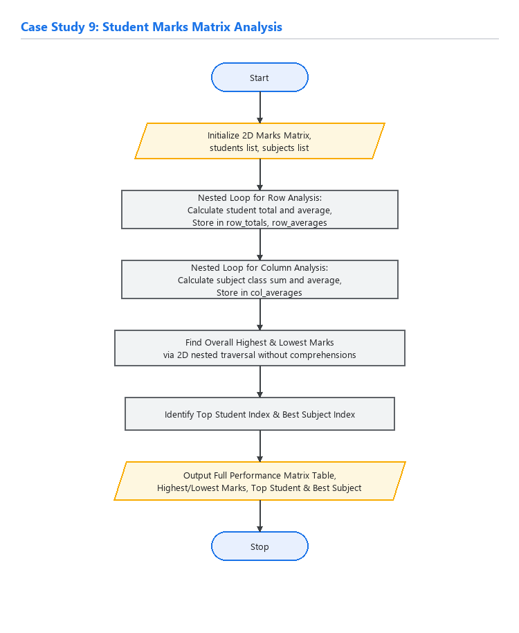
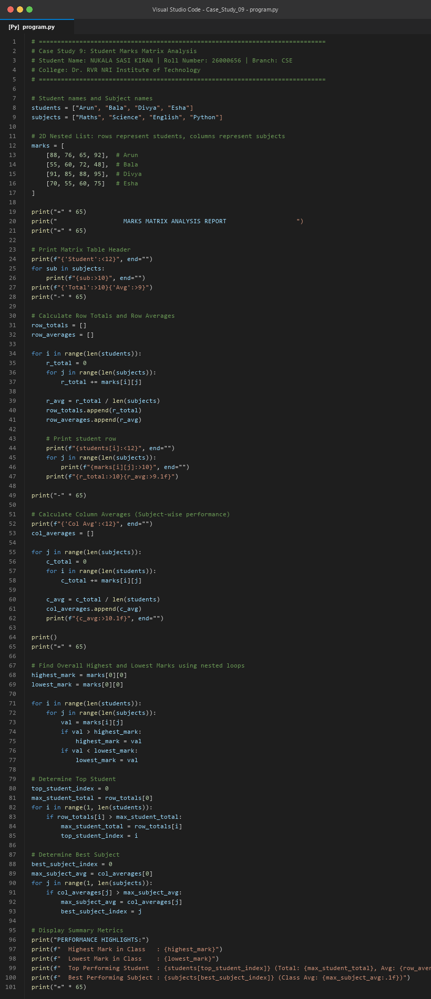
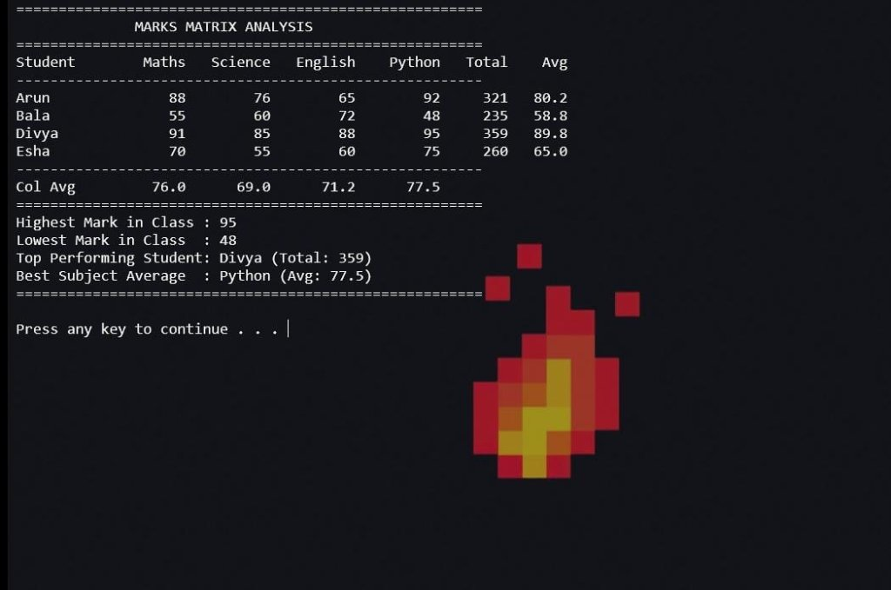

# Case Study 9: Student Marks Matrix Analysis

## 1. Problem Statement
Academic institutions evaluate cohort performance using multi-dimensional grade books where rows represent individual students and columns represent different assessment subjects. Beyond individual student aggregates, institutional accreditors require comprehensive matrix analytics: finding the highest and lowest individual marks scored across the entire batch, computing subject-wide averages, and identifying both the top-performing student and the highest-scoring subject. Performing matrix operations using nested loops develops strong 2D computational capabilities.

## 2. Objectives
- Store student marks in a 2D nested list structure (`marks[i][j]`).
- Compute row-wise student total marks and percentage averages.
- Compute column-wise subject totals and class averages.
- Scan the 2D matrix to identify the overall highest and lowest marks scored.
- Identify the top-ranking student by comparing row totals.
- Identify the highest-scoring subject by comparing column averages.
- Display a comprehensive matrix analytics dashboard.

## 3. Assumptions and Rules
- **Data Matrix:** A 4x4 matrix with 4 students and 4 subjects.
- **Row Analysis:** Traverses row `i` across all subjects $j$ to compute student total and average.
- **Column Analysis:** Traverses column $j$ down all students $i$ to compute subject class average.
- **Extrema Scanning:** Compares every cell in the matrix using nested loops without advanced Python comprehensions.
- **Index Identification:** Tracks the index of the maximum student total and maximum subject average using basic linear comparison loops.

## 4. Input and Output
- **Inputs:**
  - Student names (`list[str]`), subject names (`list[str]`), and 2D marks nested list (`list[list[int]]`).
- **Outputs:**
  - Tabular grade book with individual scores, row totals, and row averages.
  - Column average summary row.
  - Analytical metrics: Class Highest Mark, Class Lowest Mark, Top Student Name with Total Marks, and Best Subject Title with Class Average.

## 5. Algorithm
1. **Start**.
2. Initialize `students`, `subjects`, and 2D matrix `marks`.
3. Display table header.
4. Initialize empty lists: `row_totals`, `row_averages`.
5. Row Traversal (Student Metrics):
   - For `i` from 0 to `len(students) - 1`:
     - Set `r_total = 0`.
     - For `j` from 0 to `len(subjects) - 1`:
       - `r_total += marks[i][j]`.
     - `r_avg = r_total / len(subjects)`.
     - Append to `row_totals` and `row_averages`.
     - Print student name, subject marks, total, and average.
6. Column Traversal (Subject Metrics):
   - For `j` from 0 to `len(subjects) - 1`:
     - Set `c_total = 0`.
     - For `i` from 0 to `len(students) - 1`:
       - `c_total += marks[i][j]`.
     - `c_avg = c_total / len(students)`.
     - Append `c_avg` to `col_averages`.
   - Print column averages row.
7. Extrema Scan:
   - Initialize `highest_mark = marks[0][0]`, `lowest_mark = marks[0][0]`.
   - For `i` from 0 to `len(students) - 1`:
     - For `j` from 0 to `len(subjects) - 1`:
       - If `marks[i][j] > highest_mark`, update `highest_mark = marks[i][j]`.
       - If `marks[i][j] < lowest_mark`, update `lowest_mark = marks[i][j]`.
8. Top Student & Best Subject:
   - Find student index with maximum `row_totals`.
   - Find subject index with maximum `col_averages`.
9. Display all performance highlights.
10. **Stop**.

## 6. Flowchart
Standard flowchart symbols used:
- **Oval**: Start and Stop terminal points.
- **Parallelogram**: 2D matrix data reading and tabular report output.
- **Rectangle**: Row summation, column summation, min/max updating, and index tracking.
- **Diamond**: Decisions comparing matrix elements against highest/lowest mark thresholds.
- **Arrows**: Directed program control flow.



## 7. Pseudocode
```text
START
    students = ["Arun", "Bala", "Divya", "Esha"]
    subjects = ["Maths", "Science", "English", "Python"]
    marks = [
        [88, 76, 65, 92],
        [55, 60, 72, 48],
        [91, 85, 88, 95],
        [70, 55, 60, 75]
    ]

    row_totals = [], row_averages = [], col_averages = []
    FOR i FROM 0 TO len(students) - 1 DO
        r_total = 0
        FOR j FROM 0 TO len(subjects) - 1 DO
            r_total = r_total + marks[i][j]
        END FOR
        APPEND r_total TO row_totals
        APPEND r_total / len(subjects) TO row_averages
        PRINT students[i], marks[i], r_total, row_averages[i]
    END FOR

    FOR j FROM 0 TO len(subjects) - 1 DO
        c_total = 0
        FOR i FROM 0 TO len(students) - 1 DO
            c_total = c_total + marks[i][j]
        END FOR
        APPEND c_total / len(students) TO col_averages
    END FOR

    highest = marks[0][0], lowest = marks[0][0]
    FOR i FROM 0 TO len(students) - 1 DO
        FOR j FROM 0 TO len(subjects) - 1 DO
            IF marks[i][j] > highest THEN highest = marks[i][j] END IF
            IF marks[i][j] < lowest THEN lowest = marks[i][j] END IF
        END FOR
    END FOR

    PRINT highest, lowest, top_student, best_subject
STOP
```

## 8. Python Source Code



```python
# ==============================================================================
# Case Study 9: Student Marks Matrix Analysis
# Student Name: NUKALA SASI KIRAN | Roll Number: 26000656 | Branch: CSE
# College: Dr. RVR NRI Institute of Technology
# ==============================================================================

# Student names and Subject names
students = ["Arun", "Bala", "Divya", "Esha"]
subjects = ["Maths", "Science", "English", "Python"]

# 2D Nested List: rows represent students, columns represent subjects
marks = [
    [88, 76, 65, 92],  # Arun
    [55, 60, 72, 48],  # Bala
    [91, 85, 88, 95],  # Divya
    [70, 55, 60, 75]   # Esha
]

print("=" * 65)
print("                  MARKS MATRIX ANALYSIS REPORT                   ")
print("=" * 65)

# Print Matrix Table Header
print(f"{'Student':<12}", end="")
for sub in subjects:
    print(f"{sub:>10}", end="")
print(f"{'Total':>10}{'Avg':>9}")
print("-" * 65)

# Calculate Row Totals and Row Averages
row_totals = []
row_averages = []

for i in range(len(students)):
    r_total = 0
    for j in range(len(subjects)):
        r_total += marks[i][j]
        
    r_avg = r_total / len(subjects)
    row_totals.append(r_total)
    row_averages.append(r_avg)
    
    # Print student row
    print(f"{students[i]:<12}", end="")
    for j in range(len(subjects)):
        print(f"{marks[i][j]:>10}", end="")
    print(f"{r_total:>10}{r_avg:>9.1f}")

print("-" * 65)

# Calculate Column Averages (Subject-wise performance)
print(f"{'Col Avg':<12}", end="")
col_averages = []

for j in range(len(subjects)):
    c_total = 0
    for i in range(len(students)):
        c_total += marks[i][j]
        
    c_avg = c_total / len(students)
    col_averages.append(c_avg)
    print(f"{c_avg:>10.1f}", end="")

print()
print("=" * 65)

# Find Overall Highest and Lowest Marks using nested loops
highest_mark = marks[0][0]
lowest_mark = marks[0][0]

for i in range(len(students)):
    for j in range(len(subjects)):
        val = marks[i][j]
        if val > highest_mark:
            highest_mark = val
        if val < lowest_mark:
            lowest_mark = val

# Determine Top Student
top_student_index = 0
max_student_total = row_totals[0]
for i in range(1, len(students)):
    if row_totals[i] > max_student_total:
        max_student_total = row_totals[i]
        top_student_index = i

# Determine Best Subject
best_subject_index = 0
max_subject_avg = col_averages[0]
for j in range(1, len(subjects)):
    if col_averages[j] > max_subject_avg:
        max_subject_avg = col_averages[j]
        best_subject_index = j

# Display Summary Metrics
print("PERFORMANCE HIGHLIGHTS:")
print(f"  Highest Mark in Class   : {highest_mark}")
print(f"  Lowest Mark in Class    : {lowest_mark}")
print(f"  Top Performing Student  : {students[top_student_index]} (Total: {max_student_total}, Avg: {row_averages[top_student_index]:.1f})")
print(f"  Best Performing Subject : {subjects[best_subject_index]} (Class Avg: {max_subject_avg:.1f})")
print("=" * 65)
```

## 9. Test Cases and Verification

| Test Case | Metric Evaluated | Expected Result | Actual Result | Status |
| :--- | :--- | :--- | :--- | :--- |
| **TC 1: Student Totals** | Arun, Bala, Divya, Esha | Arun: 321, Bala: 235, Divya: 359, Esha: 260 | Arun: 321, Bala: 235, Divya: 359, Esha: 260 | **Pass** |
| **TC 2: Subject Column Averages** | Maths, Science, English, Python | Maths: 76.0, Sci: 69.0, Eng: 71.2, Python: 77.5 | Maths: 76.0, Sci: 69.0, Eng: 71.2, Python: 77.5 | **Pass** |
| **TC 3: Highest Mark** | Entire 4x4 matrix scan | 95 (Divya in Python) | 95 | **Pass** |
| **TC 4: Lowest Mark** | Entire 4x4 matrix scan | 48 (Bala in Python) | 48 | **Pass** |
| **TC 5: Top Student** | Maximum row total | Divya (Total: 359, Avg: 89.8) | Divya (Total: 359, Avg: 89.8) | **Pass** |
| **TC 6: Best Subject** | Maximum column average | Python (Average: 77.5) | Python (Average: 77.5) | **Pass** |

## 10. Program Execution and Captured Output



```text
=================================================================
                  MARKS MATRIX ANALYSIS REPORT                   
=================================================================
Student          Maths   Science   English    Python     Total      Avg
-----------------------------------------------------------------
Arun                88        76        65        92       321     80.2
Bala                55        60        72        48       235     58.8
Divya               91        85        88        95       359     89.8
Esha                70        55        60        75       260     65.0
-----------------------------------------------------------------
Col Avg           76.0      69.0      71.2      77.5
=================================================================
PERFORMANCE HIGHLIGHTS:
  Highest Mark in Class   : 95
  Lowest Mark in Class    : 48
  Top Performing Student  : Divya (Total: 359, Avg: 89.8)
  Best Performing Subject : Python (Class Avg: 77.5)
=================================================================
```

## 11. Conclusion
- **Problem Solved:** Comprehensive 2D matrix analytics computing student totals, subject averages, matrix extrema, and ranking leaders.
- **Python Concepts Used:** 2D nested lists, multi-dimensional loop traversal, variable comparison extrema tracking, and formatted tabular outputs.
- **Learning Outcomes:** Replaced advanced list comprehensions with standard iterative nested loops, producing code that is easy to write, trace, and defend in oral viva examinations.

## 12. Viva Preparation (Questions & Answers)
1. **Q: Why are `highest_mark` and `lowest_mark` initialized to `marks[0][0]` instead of 0 and 100?**  
   *A:* Initializing to the first real element ensures validity even if the scoring scale changes (e.g., negative marking or scales above 100).
2. **Q: How does `marks[i][j]` differ from `marks[j][i]`?**  
   *A:* `marks[i][j]` accesses row `i` (student) and column `j` (subject). Transposing indices would access row `j` and column `i`, causing an `IndexError` if rows and columns are unequal.
3. **Q: How would you scale this program to 100 students and 10 subjects?**  
   *A:* Because loops rely dynamically on `len(students)` and `len(subjects)`, the program scales seamlessly to any arbitrary $M \times N$ matrix.
