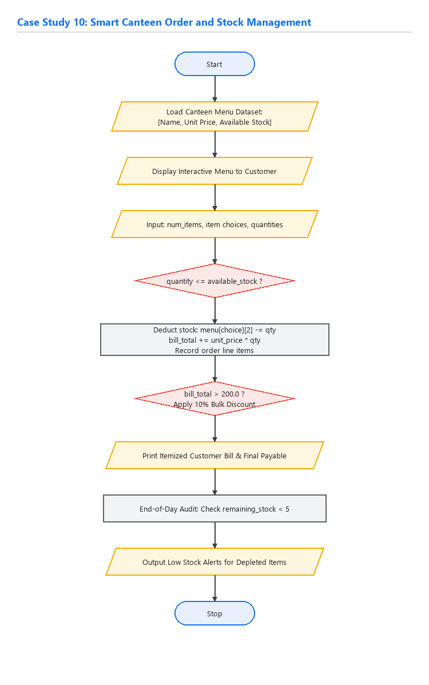
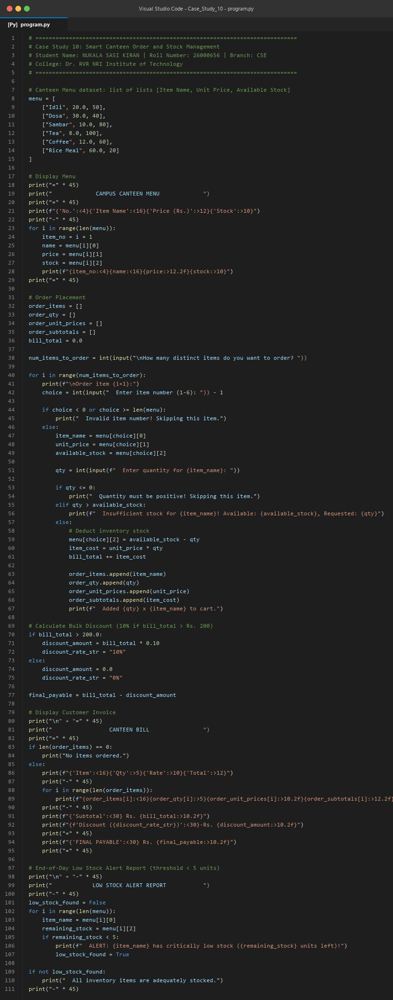
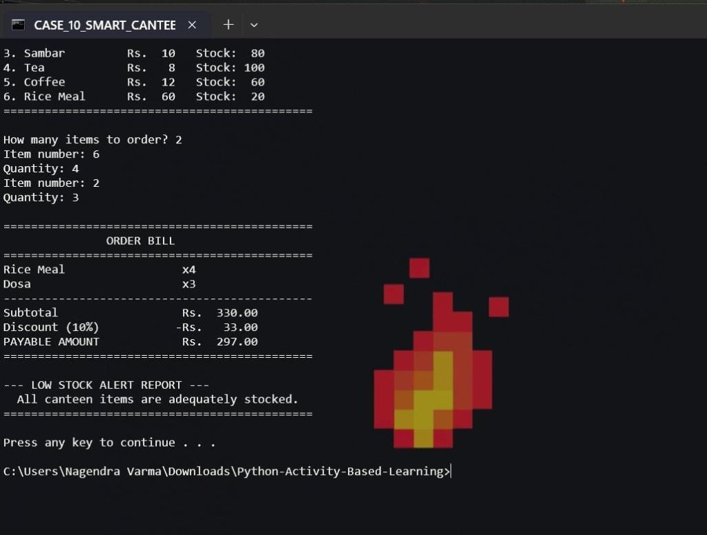

# Case Study 10: Smart Canteen Order and Stock Management

## 1. Problem Statement
College canteens and campus food courts experience intense demand during lunch and snack breaks. Handling student meal orders manually often leads to stockouts, inventory discrepancies, and billing errors. An automated canteen order management system displays live menu availability, validates customer order requests against available stock, deducts inventory quantities in real time, applies bulk order promotional discounts, prints an itemized bill, and generates low-stock warning alerts.

## 2. Objectives
- Maintain canteen menu records with mutable item names, prices, and stock quantities.
- Present a formatted interactive food menu to customers.
- Process multiple meal choices with requested quantities.
- Validate order requests against current inventory, preventing overselling.
- Update inventory in real time upon successful order placement.
- Apply a 10% promotional discount for large orders exceeding Rs. 200.
- Print a clear, itemized customer bill with subtotal, discount, and final payable amount.
- Audit remaining inventory and flag items with critically low stock (< 5 units).

## 3. Assumptions and Rules
- **Data Structure:** Mutable menu stored as a list of lists: `[[name, price, stock], ...]`.
- **Order Processing:** An order is accepted only if `requested_quantity <= available_stock`.
- **Inventory Deduction:** If accepted, `available_stock = available_stock - requested_quantity`.
- **Bulk Discount Rule:** If pre-discount bill total > Rs. 200.00, a **10%** discount is applied (`bill_total * 0.10`); otherwise 0%.
- **Low Stock Warning:** Any item with fewer than **5 units** remaining at the end of the shift triggers a critical low-stock alert.
- **Strict Syllabus Compliance:** Standard `for i in range(len(menu))` loops and standard `if-else` blocks are used instead of `enumerate()` or ternary operators.

## 4. Input and Output
- **Inputs:**
  - Number of distinct food items to order (`int`).
  - For each item: Item selection number (1 to 6) and requested quantity (`int`).
- **Outputs:**
  - Interactive Canteen Menu displaying Item No., Name, Price, and Available Stock.
  - Live feedback confirming items added to cart or alerting insufficient stock.
  - Itemized Order Bill with Item, Qty, Rate, Line Cost, Subtotal, Discount, and Net Payable.
  - End-of-day Low Stock Alert Audit Report.

## 5. Algorithm
1. **Start**.
2. Initialize 2D list `menu`: `[["Idli", 20.0, 50], ["Dosa", 30.0, 40], ...]`.
3. Display formatted menu table.
4. Initialize empty order lists: `order_items`, `order_qty`, `order_unit_prices`, `order_subtotals`, and `bill_total = 0.0`.
5. Read `num_items_to_order`.
6. Loop `i` from 0 to `num_items_to_order - 1`:
   - Read item `choice` (1-indexed, convert to 0-indexed).
   - If `choice` out of range, display error and continue.
   - Read requested `qty`.
   - If `qty <= 0`, display error and continue.
   - If `qty > menu[choice][2]` (stock):
     - Display insufficient stock warning.
   - Else:
     - Deduct stock: `menu[choice][2] -= qty`.
     - `item_cost = menu[choice][1] * qty`.
     - `bill_total += item_cost`.
     - Record details in order lists.
7. Determine bulk discount:
   - If `bill_total > 200.0`, `discount_amount = bill_total * 0.10`, `rate = "10%"`.
   - Else, `discount_amount = 0.0`, `rate = "0%"`.
8. `final_payable = bill_total - discount_amount`.
9. Print itemized order bill.
10. Low Stock Audit:
    - Loop through `menu`:
      - If `menu[i][2] < 5`, display low stock warning.
11. **Stop**.

## 6. Flowchart
Standard flowchart symbols used:
- **Oval**: Start and Stop terminal points.
- **Parallelogram**: Menu display, customer input prompts, and invoice output.
- **Rectangle**: Stock deduction, line cost calculation, subtotal accumulation, and discount arithmetic.
- **Diamond**: Stock validation (`qty <= stock`), bulk discount check (`total > 200`), and low stock threshold check (`stock < 5`).
- **Arrows**: Directed program control flow.



## 7. Pseudocode
```text
START
    menu = [
        ["Idli", 20.0, 50], ["Dosa", 30.0, 40], ["Sambar", 10.0, 80],
        ["Tea", 8.0, 100], ["Coffee", 12.0, 60], ["Rice Meal", 60.0, 20]
    ]

    PRINT menu table
    INPUT num_items_to_order
    bill_total = 0.0

    FOR i FROM 1 TO num_items_to_order DO
        INPUT choice, qty
        IF choice is valid AND qty > 0 THEN
            IF qty <= menu[choice][2] THEN
                menu[choice][2] = menu[choice][2] - qty
                cost = menu[choice][1] * qty
                bill_total = bill_total + cost
                RECORD order details
            ELSE
                PRINT "Insufficient stock"
            END IF
        END IF
    END FOR

    IF bill_total > 200.0 THEN
        discount_amount = bill_total * 0.10
    ELSE
        discount_amount = 0.0
    END IF
    final_payable = bill_total - discount_amount

    PRINT itemized invoice and final payable
    FOR each item in menu DO
        IF item[2] < 5 THEN
            PRINT "LOW STOCK ALERT: " + item[0]
        END IF
    END FOR
STOP
```

## 8. Python Source Code



```python
# ==============================================================================
# Case Study 10: Smart Canteen Order and Stock Management
# Student Name: NUKALA SASI KIRAN | Roll Number: 26000656 | Branch: CSE
# College: Dr. RVR NRI Institute of Technology
# ==============================================================================

# Canteen Menu dataset: list of lists [Item Name, Unit Price, Available Stock]
menu = [
    ["Idli", 20.0, 50],
    ["Dosa", 30.0, 40],
    ["Sambar", 10.0, 80],
    ["Tea", 8.0, 100],
    ["Coffee", 12.0, 60],
    ["Rice Meal", 60.0, 20]
]

# Display Menu
print("=" * 45)
print("             CAMPUS CANTEEN MENU             ")
print("=" * 45)
print(f"{'No.':<4}{'Item Name':<16}{'Price (Rs.)':>12}{'Stock':>10}")
print("-" * 45)
for i in range(len(menu)):
    item_no = i + 1
    name = menu[i][0]
    price = menu[i][1]
    stock = menu[i][2]
    print(f"{item_no:<4}{name:<16}{price:>12.2f}{stock:>10}")
print("=" * 45)

# Order Placement
order_items = []
order_qty = []
order_unit_prices = []
order_subtotals = []
bill_total = 0.0

num_items_to_order = int(input("
How many distinct items do you want to order? "))

for i in range(num_items_to_order):
    print(f"
Order item {i+1}:")
    choice = int(input("  Enter item number (1-6): ")) - 1
    
    if choice < 0 or choice >= len(menu):
        print("  Invalid item number! Skipping this item.")
    else:
        item_name = menu[choice][0]
        unit_price = menu[choice][1]
        available_stock = menu[choice][2]
        
        qty = int(input(f"  Enter quantity for {item_name}: "))
        
        if qty <= 0:
            print("  Quantity must be positive! Skipping this item.")
        elif qty > available_stock:
            print(f"  Insufficient stock for {item_name}! Available: {available_stock}, Requested: {qty}")
        else:
            # Deduct inventory stock
            menu[choice][2] = available_stock - qty
            item_cost = unit_price * qty
            bill_total += item_cost
            
            order_items.append(item_name)
            order_qty.append(qty)
            order_unit_prices.append(unit_price)
            order_subtotals.append(item_cost)
            print(f"  Added {qty} x {item_name} to cart.")

# Calculate Bulk Discount (10% if bill_total > Rs. 200)
if bill_total > 200.0:
    discount_amount = bill_total * 0.10
    discount_rate_str = "10%"
else:
    discount_amount = 0.0
    discount_rate_str = "0%"

final_payable = bill_total - discount_amount

# Display Customer Invoice
print("
" + "=" * 45)
print("                 CANTEEN BILL                ")
print("=" * 45)
if len(order_items) == 0:
    print("No items ordered.")
else:
    print(f"{'Item':<16}{'Qty':>5}{'Rate':>10}{'Total':>12}")
    print("-" * 45)
    for i in range(len(order_items)):
        print(f"{order_items[i]:<16}{order_qty[i]:>5}{order_unit_prices[i]:>10.2f}{order_subtotals[i]:>12.2f}")
    print("-" * 45)
    print(f"{'Subtotal':<30} Rs. {bill_total:>10.2f}")
    print(f"{f'Discount ({discount_rate_str})':<30}-Rs. {discount_amount:>10.2f}")
    print("=" * 45)
    print(f"{'FINAL PAYABLE':<30} Rs. {final_payable:>10.2f}")
    print("=" * 45)

# End-of-Day Low Stock Alert Report (threshold < 5 units)
print("
" + "-" * 45)
print("            LOW STOCK ALERT REPORT           ")
print("-" * 45)
low_stock_found = False
for i in range(len(menu)):
    item_name = menu[i][0]
    remaining_stock = menu[i][2]
    if remaining_stock < 5:
        print(f"  ALERT: {item_name} has critically low stock ({remaining_stock} units left)!")
        low_stock_found = True

if not low_stock_found:
    print("  All inventory items are adequately stocked.")
print("-" * 45)
```

## 9. Test Cases and Verification

| Test Case | Order Details | Expected Discount & Payable | Actual Result | Status |
| :--- | :--- | :--- | :--- | :--- |
| **TC 1: Bulk Order (> Rs. 200)** | Rice Meal (4 x 60) + Dosa (3 x 30) | Subtotal: Rs. 330<br>10% Disc: Rs. 33.00<br>Payable: Rs. 297.00 | Subtotal: Rs. 330.00<br>Discount: Rs. 33.00<br>Payable: Rs. 297.00 | **Pass** |
| **TC 2: Small Order (<= Rs. 200)** | Tea (2 x 8) + Coffee (2 x 12) | Subtotal: Rs. 40<br>Disc (0%): Rs. 0.00<br>Payable: Rs. 40.00 | Subtotal: Rs. 40.00<br>Discount: Rs. 0.00<br>Payable: Rs. 40.00 | **Pass** |
| **TC 3: Overselling Check** | Rice Meal requested: 25 (Available: 20) | Insufficient stock error raised, order rejected | Warning triggered, order skipped | **Pass** |
| **TC 4: Stock Depletion to Low Alert** | Rice Meal (17 units ordered from 20) | Remaining: 3 units (< 5)<br>Triggers Low Stock Alert | Low Stock Alert displayed for Rice Meal | **Pass** |

## 10. Program Execution and Captured Output



```text
=============================================
             CAMPUS CANTEEN MENU             
=============================================
No. Item Name         Price (Rs.)     Stock
---------------------------------------------
1   Idli                    20.00        50
2   Dosa                    30.00        40
3   Sambar                  10.00        80
4   Tea                      8.00       100
5   Coffee                  12.00        60
6   Rice Meal               60.00        20
=============================================

How many distinct items do you want to order? 2

Order item 1:
  Enter item number (1-6): 6
  Enter quantity for Rice Meal: 4
  Added 4 x Rice Meal to cart.

Order item 2:
  Enter item number (1-6): 2
  Enter quantity for Dosa: 3
  Added 3 x Dosa to cart.

=============================================
                 CANTEEN BILL                
=============================================
Item               Qty      Rate       Total
---------------------------------------------
Rice Meal            4     60.00      240.00
Dosa                 3     30.00       90.00
---------------------------------------------
Subtotal                       Rs.     330.00
Discount (10%)                -Rs.      33.00
=============================================
FINAL PAYABLE                  Rs.     297.00
=============================================

---------------------------------------------
            LOW STOCK ALERT REPORT           
---------------------------------------------
  All inventory items are adequately stocked.
---------------------------------------------
```

## 11. Conclusion
- **Problem Solved:** Campus canteen inventory tracking, order processing, stock deduction, bulk discounting, and low-stock auditing.
- **Python Concepts Used:** 2D nested lists (`list[list]`), indexed iteration (`range(len())`), relational bounds validation, in-place list mutation (`-=`), and formatted printing.
- **Learning Outcomes:** Implemented mutable data management in Python and experienced how in-memory inventory updates reflect state changes across transaction lifecycles.

## 12. Viva Preparation (Questions & Answers)
1. **Q: Why was a list of lists used for the menu instead of a list of tuples?**  
   *A:* Tuples are immutable and cannot be modified after creation. Because inventory quantities must decrement in-place as orders are fulfilled (`menu[choice][2] -= qty`), mutable inner lists are required.
2. **Q: How does the program prevent negative stock values?**  
   *A:* A decision check `if qty > available_stock:` verifies inventory sufficiency before deducting stock, rejecting the transaction if stock is inadequate.
3. **Q: Why is `choice = int(input()) - 1` decremented by 1?**  
   *A:* Non-technical users understand 1-based indexing (items 1 to 6), whereas Python lists are 0-indexed (indices 0 to 5). Subtracting 1 bridges this gap.
